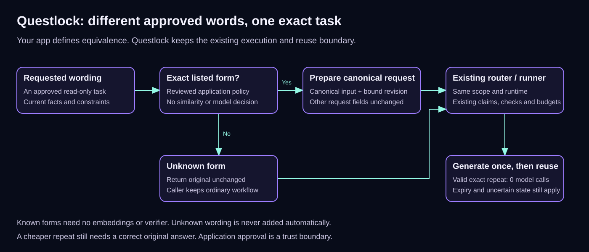

# Reuse questions your app already understands

A support form, a command palette and an agent can ask for the same password
reset steps in different words. If your application already knows those forms
mean the same request, another model call shouldn't be needed to compare them.

`delegation.ApplyApprovedQuestions` prepares one ordinary exact request from a
finite list of reviewed questions. It makes no network call, reads no storage
and runs no model. The normal router still owns generation, checks, shared
claims, budgets and exact reuse.

This is an explicit application contract. It does not recognize new paraphrases,
learn from model answers or decide that two business requests are equivalent.



[Editable draw.io source](diagrams/approved-questions.drawio).

## Start with the questions you already support

Keep the policy in your application configuration. For example:

```json
{
  "read_only": true,
  "revision": "password-help-1",
  "intent": "explain-password-reset",
  "bindings": {
    "account_type": "customer",
    "email_access": "available"
  },
  "canonical_question": "Explain the password reset steps for this account.",
  "forms": [
    "Explain the password reset steps for this account.",
    "How do I reset the password for this account?",
    "Show me the password reset steps for this account."
  ]
}
```

Supply the actual reset policy and account facts in the request's instructions
and context. `bindings` partitions the approved contract; it does not add those
facts to the model prompt. A customer without email access needs updated facts
and bindings, even if the question text is unchanged.

Use the helper before calling your configured router:

```go
func runApproved(ctx context.Context, router delegation.Router,
    original delegation.Request, policy delegation.ApprovedQuestionSet,
) (delegation.Result, error) {
    prepared, decision, err := delegation.ApplyApprovedQuestions(original, policy)
    if err != nil {
        return delegation.Result{}, err
    }
    // decision.Matched tells your app whether an approved form was selected.
    // An unknown form leaves the original request unchanged. You may withhold
    // it here, or send it through your ordinary configured workflow.
    _ = decision
    return router.Run(ctx, prepared)
}
```

The types come from `github.com/spfuzzylink/questlock/delegation`; the function
also imports Go's `context` package. See [Go integration](go-integration.md) for
provider and broker wiring. The helper changes neither route nor escalation.
For local-only work, keep the existing single Ollama tier and paid fallback off.

## What repeats, and what runs again

For an exact listed form, the helper sets the canonical input and a derived
revision that includes the complete approved policy and original revision.
The normal request fingerprint still covers instructions, context, checks,
tiers and limits; the runner also binds the runtime and authenticated scope.

The first canonical request can generate normally. Another approved form can
then replay that completed result without an embedding or verifier call. A
pending or uncertain result still stops. Source expiry, changed evidence,
bindings, policy revision, model/runtime or checks do not become reusable merely
because the form is listed. Reading an answer does not extend its reuse window.

Unknown forms are returned unchanged. Matching is byte for byte: no trimming,
case folding, Unicode normalization, regex or similarity search. Changing
“remaining steps” to “completed steps only” is not an approved match unless the
application incorrectly puts both in the same set. Review that list as code.

Prepare an original request once, then execute or retry the prepared request
directly. Applying the helper again to its reserved `approved-questions-v1-`
revision is an error; it must not create new task identities around pending work.
Do not combine this preparation with `semantic_reuse` or `semantic_shadow`.

## Bounds and trust

Use 2–32 unique forms, including the canonical question. Each question is at
most 8,192 UTF-8 bytes. The encoded policy plus original revision has a 32 KiB
ceiling. Policy revision and intent are at most 128 bytes. There may be 32
bindings, with keys up to 64 bytes and values up to 256 bytes.

`read_only: true` is the application's declaration. This helper does not perform
an account reset, issue a refund or authorize tools. It also cannot make a wrong
source answer correct. Keep factual checks and review on the original task.
Usage and acceptance remain separate: zero new tokens on a repeat is not proof
that a person accepted the answer.

For questions outside a reviewed set, [controlled semantic reuse](controlled-reuse.md)
is a separate experimental path. Its verifier has a cost and can be wrong.

[Validation and retained failed approaches](reuse-efficiency-validation-v0.16.0.md).
