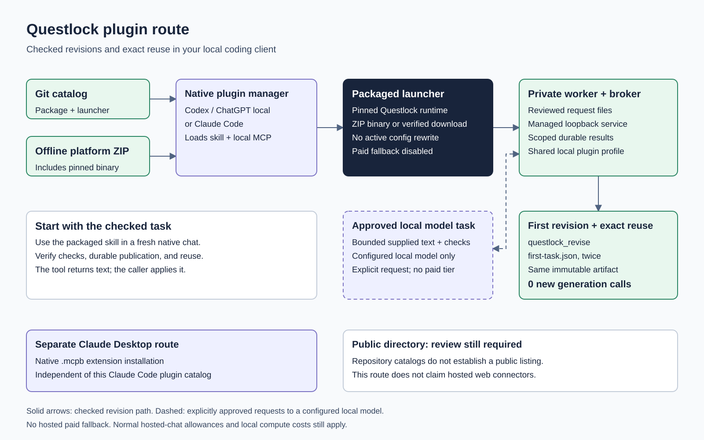
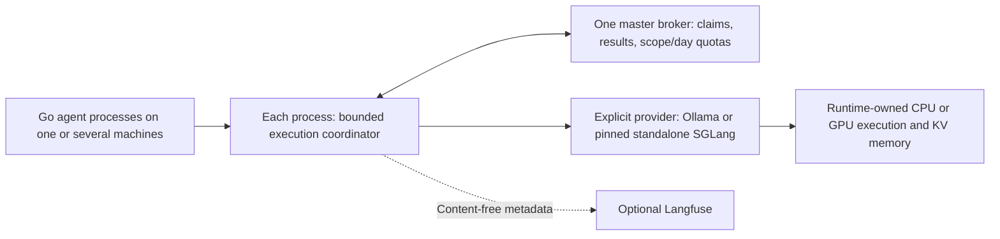
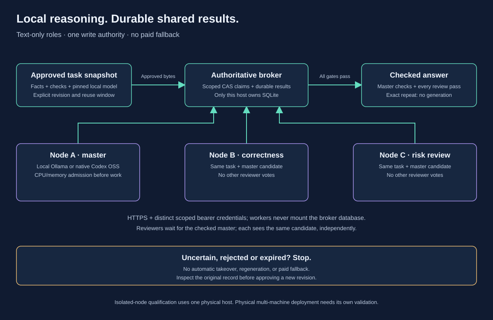
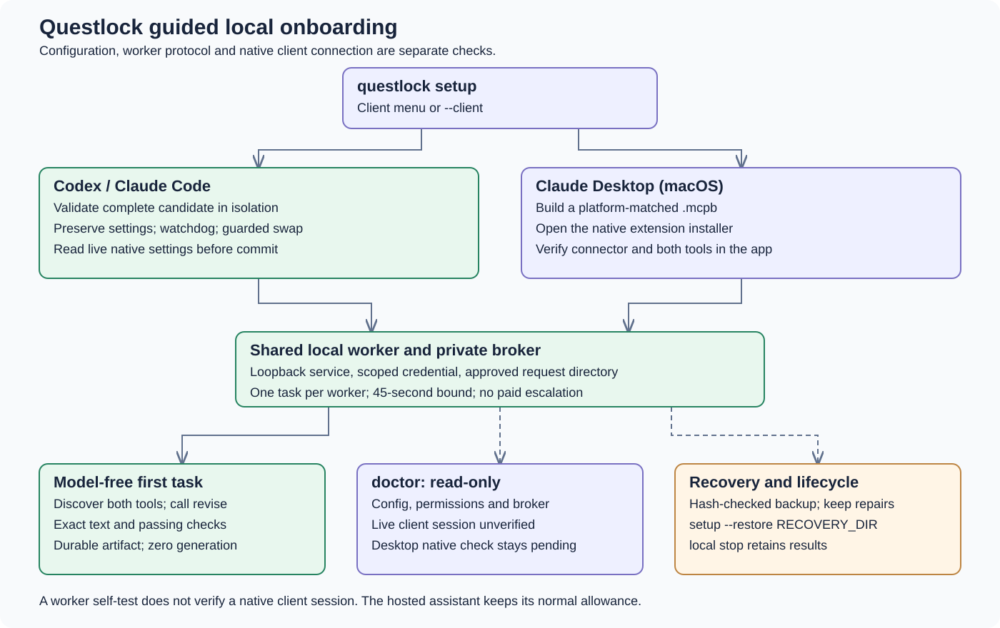
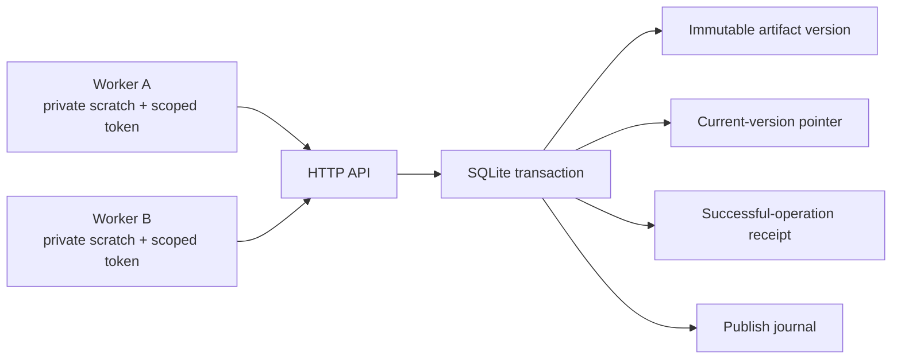
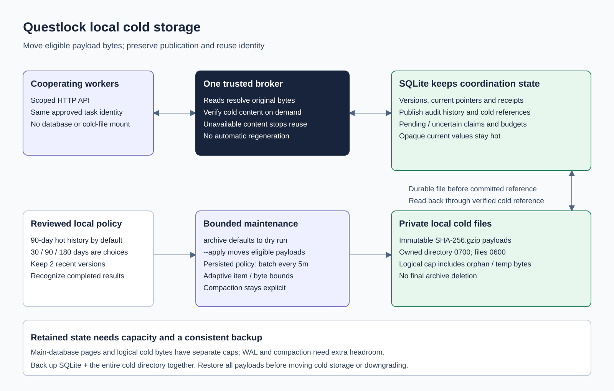
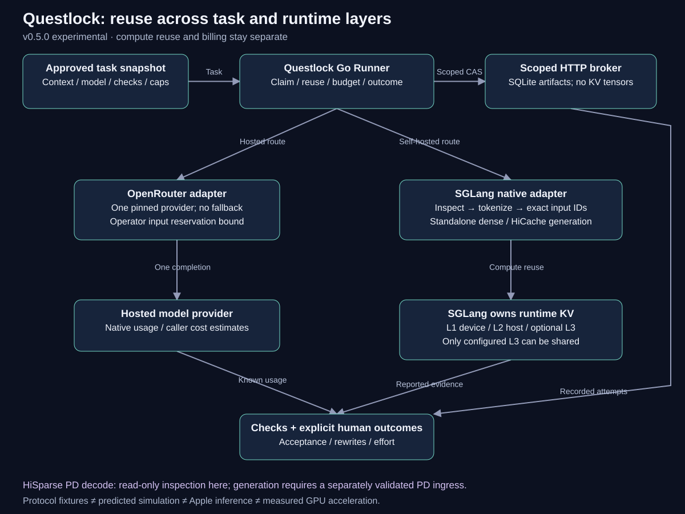
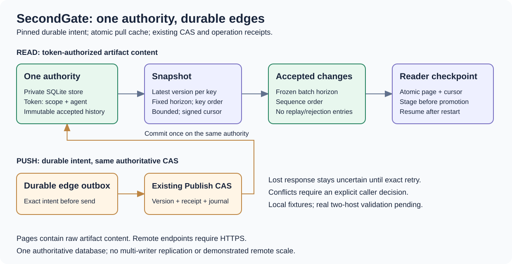

# Architecture

## Client plugins

The plugins are thin packages around the same Go runtime. A native client owns
installation and enablement; its launcher uses a bundled executable or fetches
the pinned release into a private cache. It starts the existing loopback worker
and broker in a separate plugin profile. Both clients can share checked results
without touching the configuration used by guided setup. Paid fallback stays
disabled. See [installation and lifecycle](plugins.md) and the
[editable plugin flow](diagrams/plugins.drawio).

## Go applications and a shared master broker

One `execution.Coordinator` combines the existing runner, bounded local admission
and optional telemetry. Share that instance inside a process. Across machines,
workers use scoped HTTPS clients to reach one authoritative broker. The broker
stores claims, results and opt-in token/dollar ledgers; each process still owns
its own CPU/memory admission. SGLang or Ollama owns the model's device memory.

See the [Go integration and declarative examples](go-integration.md). Exact reuse
can skip generation; a new task must reserve its configured quota first. Unknown
outcomes retain reservations. Quotas coordinate trusted, configured workers;
they cannot meter calls made outside this path. This adds neither automatic
multi-writer replication nor a distributed CPU/GPU resource scheduler.

## Local master and reviewers

An approved text snapshot can now run through a local master and independent
reviewers, using direct Ollama or an isolated native Codex OSS harness. Scoped
broker CAS claims coordinate roles across worker processes; only the broker
owns SQLite. Deterministic checks and every review must pass before the final
answer is exposed. Exact checked reuse needs no generation. Pending or uncertain
claims stop without automatic takeover, regeneration or paid fallback.

Each fresh role waits for healthy local CPU/memory capacity before publishing its
claim; the invocation deadline bounds that wait. Direct Ollama roles can opt into
JSON output and nonstreaming reasoning. When the master requests JSON, reviewers
receive its parsed candidate value. The total output cap includes reasoning and final-answer tokens;
raw thinking is discarded rather than published. An optional
`keep_alive_seconds: 0` asks the shared Ollama daemon to release the requested
model after its response, trading resident memory for later cold starts. This
changes model retention, not global memory reservation or retry behavior. Requests
that omit these controls keep their existing defaults and representation.

A direct Ollama master can declare primitive `output_types` explicitly. Questlock
adds a bounded types-only decoder schema and generic source-grounding system
instructions, while keeping the canonical user prompt unchanged. It supplies no
answer values, never derives types from expected checks, and never rewrites a
response to make it pass. Optional manual `field_roles` distinguish quantities,
policy actions and copied identifiers, including numeric-looking source codes.
Reviewers see these declarations as reference data; their fixed approval
contract stays separate. The comparison discloses the extra operator
interpretation and runtime guidance; it does not claim identical-information
model parity. Original semantic checks remain the final gate for a well-typed
but incorrect answer.

The [team guide](local-agent-teams.md) covers role handoff, HTTPS/private CA
deployment, failure recovery and matched baseline receipts, with
[editable draw.io source](diagrams/local-agent-teams.drawio). Role names and
worker labels are not per-role authorization. Local resource admission remains
per process; this does not add distributed placement, broker failover or an
automatic replacement for the active hosted chat. Qualification uses isolated
nodes on one physical host; physical multi-machine validation remains separate.

## Guided local onboarding (v0.7.0)

`questlock setup` connects Codex or Claude Code through a complete isolated
candidate, native configuration validation, and a guarded live swap. Claude
Desktop uses a bundled native extension and its own installer. All three routes
use the same private loopback broker and approved request boundary; onboarding
does not enable paid escalation. The first task checks the worker protocol with
no model call. That evidence stays separate from a native client connection.

Follow the [onboarding guide](onboarding.md) for the shortest setup route,
read-only diagnostics and recovery. The diagram has
[editable draw.io source](diagrams/onboarding.drawio).

## Checked deterministic revisions (v0.6.0)

The new Go `revision` path composes with the same scoped publication boundary.
It verifies exact source bytes/digest and declared source checks, applies an
ordered counted literal edit plan, and checks the output before publishing to
`revision/v1/results/<request_digest>`. Each immutable result links source and
output digests plus an optional exact parent key/version. Workers exchange text
through HTTP; they receive neither the SQLite file nor an execution tool.

A revision has no provider or model call. An inline preview is fully offline;
a shared parent read and durable run use broker authentication. Concurrent exact
plans converge on the same immutable result. Digest/count/check failure or
uncertain publication withholds text and stops without fallback. Optional outcome
accounting stays separate from human acceptance. See the [request and failure
contract](checked-revisions.md) and [editable flow](diagrams/checked-revisions.drawio).
[Tagged publication and installed-worker evidence](validation.md#v060-observations--2026-10-16)
are verified for v0.6.0.

Questlock has one trusted broker and multiple independently authenticated workers.
It protects publication of shared UTF-8 artifacts on one host.

Workers never receive the SQLite volume. The server derives the scope from the
token; scope is not accepted as a publication parameter. A worker with a valid
token can read and publish any key in that scope.

## Publication sequence

1. Authenticate the credential and validate the request.
2. Begin an immediate SQLite transaction; recheck that the token is active.
3. Look up the agent's operation ID. If the exact successful request already
   exists, return its original artifact and record a replay against the current head.
4. Reject reuse of a successful operation ID with different request data.
5. Compare `expected_version` to the artifact's current version. A missing key has
   version 0. Record a conflict without changing the artifact if they differ.
6. Insert the new immutable version, update the head, save the successful receipt,
   and journal the acceptance in one transaction. Acknowledge only after commit.

Publication commits content inside SQLite. With optional local retention, an
eligible payload can later move into an immutable compressed file. The file is
durable before a transaction replaces the inline payload with its reference;
an interrupted archive can leave an unreferenced file, never an acknowledged
reference to an unfinished write. WAL with FULL synchronization provides the
tested process-restart behavior; durability under physical power loss also
depends on filesystem/device guarantees.

## Local cold storage

**Questlock** keeps artifact identities, current pointers, successful-operation
receipts and audit entries in SQLite. Opt-in retention moves only eligible
content: older noncurrent versions beyond the recent-version allowance, plus
recognized complete inference results and immutable revision results when the
policy permits it. Opaque current values, pending or uncertain claims, budget
ledgers, team state and outcome records stay hot. Reads, exact retries and reuse
verify and resolve the same bytes from either location.

The [operator guide](storage-retention.md) covers policy, bounded scheduled
maintenance, dry runs, restore and explicit compaction. The diagram has an
[editable draw.io source](diagrams/storage-retention.drawio). There is no archive
deletion or independent backup service. SQLite metadata and cold files must be
backed up together; the database page limit excludes WAL and compaction headroom.

## Retry semantics

An operation ID is scoped to an agent and permanently bound to one successful
request. Retrying that exact request returns the same artifact, even when later
versions exist. It does not set the head back to that older version.

The worker must retain the request before sending it if it wants to recover after
a crash. A fresh ID after a lost response can create a second effect. A rejected
request has no successful receipt; corrected work should use a fresh operation ID.

## Model-task coordination

The Go inference Runner builds on this publication boundary to claim exact
model tasks, save results, and coordinate optional shared API budget reservations.
Workers call the selected model provider; the broker owns the database and
receives no provider API key. Job claims and the daily budget ledger use separate
CAS publications, rather than one multi-key transaction.

Version **v0.3.0** adds current-run phase/usage measurements,
optional local content-stream timing, explicit evaluation checks, and a bounded
stdio MCP worker. The worker reads only an approved request inside its declared
workspace and can run at most one explicit escalation after a confirmed complete,
durable, valid-known-usage answer fails the checks. It provides no shell/file-edit
tools or full-session proxy. Hosted escalation requires process permission and
explicit prices/caps; validated local work leaves the paid ledger untouched.

Optional Langfuse receives allowlisted content-free metadata after execution,
without changing durable results or triggering generation retries. Invocation
metrics do not enter job identity; original streaming timing remains historical
response data. See the [runtime architecture and export contract](inference-observability.md),
[delegation boundary](delegation.md), and [local measurements](measurements-v0.3.0.md).

See the [system-boundary and task-lifecycle diagrams](model-architecture.md#editable-architecture-diagrams)
for SVG views and a two-page editable draw.io source. The same guide retains a
Mermaid request-flow view and explains reuse, uncertain outcomes, and settlement.

## Provider routing and runtime caches

The **v0.5.0 experimental release** added two explicit integration
contracts. OpenRouter uses one declared model/provider route, an operator input
reservation bound, and strict native usage partitions. Its requested upstream
fallbacks are disabled; Questlock does not retry uncertain generation. Direct
OpenAI Responses and Anthropic Messages retain their own counting protocols.

Self-hosted SGLang v0.5.20 supports bounded native generation on standalone dense
and HiCache engines. Before looking up a stored answer, the Runner rechecks the
observed runtime identity; a restart or configuration change stops that provider
instance rather than silently adopting a different deployment. HiSparse and PD
prefill/decode engines support configuration inspection only in this release;
the adapter does not supply a PD ingress or bootstrap/transfer orchestration.

The diagram has [editable draw.io source](diagrams/runtime-layers.drawio).
It supplements the historical v0.3/v0.4 runtime and outcome views above.

Questlock's SQLite artifacts contain coordination/results, never runtime KV
tensors. SGLang owns its L1/device, L2/host and optional shared L3 storage.
The configured namespace separates cache keys and is not an ACL. Runtime KV hit
counters stay separate from billable API cache-read/write tokens. Explicitly
self-hosted work skips the paid ledger while retaining hardware and operating
costs outside it. Optional Langfuse runtime metadata has no task text, endpoints,
model paths or credentials. See [contracts and evidence levels](runtime-cache.md).

`model runtime-quest` checks six deterministic HTTP-fixture scenarios without a
GPU. `model runtime-inspect` returns `capabilities`,
`evidence: "runtime_reported_configuration"`, and `gpu_validated: false`.
Neither establishes kernel execution, a HiSparse deployment, or speedup.
Tagged publication is verified; live GPU qualification remains pending.

## Explicit human outcome records

**v0.4.0 experimental** adds an `outcomes` Go package and
CLI on the same scoped artifact boundary. Opted-in worker requests publish
content-free invocation and attempt metadata. Reviewers explicitly record
acceptance, rewriting, rejection, or reopening; check success never implies
human acceptance. Each event links a run ID and uses an expected version and
idempotent event ID. A rewrite clears acceptance until a later explicit
acceptance identifies the final artifact digest.

The diagram has [native editable draw.io source](diagrams/human-outcomes.drawio).
Outcome JSON uses the existing broker and SQLite transactions, with no schema
migration or second database. It is application data inside a cooperative scope;
scope access does not authenticate the reviewer as a person. Apps must obtain
intentional human decisions and maintain their own identity controls.

Every new outcome-artifact version contains the full ledger. Per-ledger run,
event, and byte limits bound its current content but do not cap cumulative
artifact history. Retention, database-growth monitoring, and backups remain
operator responsibilities.

The cohort report includes all its recorded attempts and explicit incremental
review effort, including failed and rejected work, divided by currently accepted
outcomes when all inputs are known. Missing accounting stays unknown; zero
accepted outcomes has no unit-cost result. Each task is read at an observed
version rather than in one atomic cross-task snapshot. Outcome registration is
separate from inference and never triggers generation retries; tracking failure
must be recovered through the metadata receipt path. See
[the feedback guide](outcomes.md) for schema limits, recovery, and cost coverage.
The cohort counts task ID/revision pairs; it does not deduplicate revisions of
one business deliverable. Immutable missing effort cannot be retrospectively
corrected in this release and continues to make the combined metric unknown.

## SecondGate: durable edge coordination

One authoritative store exports bounded snapshots and accepted-publication
changes in the authenticated token's scope. Immutable versions and accepted
audit IDs reconstruct each frozen horizon; signed cursors retain it across
pages and process restarts. Each private edge database persists a complete
immutable publish request before forwarding it to the broker's existing CAS.
The dedicated pinned publish route checks an authority/scope/receipt-agent
tuple in the CAS transaction; older brokers reject that unknown route before
writing, and the SDK never falls back to an unpinned publication. Uncertain
requests survive restart for explicit exact retry; first-attempt known conflicts
block until a caller decision. There is no automatic overwrite or fresh op ID.

Pull stages a frozen snapshot privately, then promotes it atomically. Each
accepted change page and its checkpoint commit together. Historical publication
receipts never update the read cache. Each edge has its own owned private
SQLite files, one live owner, hard retained-intent/cache/byte limits and usage
counts suitable for an optional shared admission controller. Pressure can delay
new work; it cannot discard durable intents or relax the authoritative CAS.

Run `questlock edge quest` without Go or a model for six real loopback/private-
SQLite scenarios. See the [SDK, protocol and offline cases](second-gate.md), with
[editable draw.io source](diagrams/second-gate.drawio). Pages contain raw artifact
content. This adds no multi-writer acceptance, scheduler, or failover; real
two-host integration remains unvalidated.

## What grows next

SQLite serializes writers. Artifact identities, receipts and journal history
remain retained. Optional [local cold storage](storage-retention.md) reduces hot
payload bytes and can cap main-database pages and logical cold bytes; it does
not cap total host disk use. Metadata growth eventually stops writes at the
configured page limit. The current-key list remains capped; SecondGate provides
scoped snapshot/change pagination, and local `storage history` reads one exact
historical version. This retains one authoritative host without failover.

Future experiments include task-generation fencing and measuring coordination
across two physical machines. Those are questions, not implemented guarantees.

See [SECURITY.md](../SECURITY.md) for the trusted operator/worker boundary and the
difference between publication controls and an execution sandbox.

`local-agent` is a separate native Codex OSS harness launch: explicit installed
local model, fixed loopback Ollama, private temporary client home, no imported
credentials or active client config writes. Its tool execution uses Codex's
selected sandbox. It does not proxy the hosted desktop chat or replicate model
weights; successful tool use still needs task-specific review.

## Local resource admission and explicit policy

The opt-in [shared local control loop](local-coordination.md) connects exact reuse,
checked revisions, local typed choices, deliberate local reasoning and accepted
shared state. [Adaptive admission](adaptive-admission.md) samples host/container
signals and protects broker headroom. It changes admission, not task content,
permissions, CAS or existing MCP single-active behavior. Operators select their
own [personal policy presets](../examples/preferences/README.md).
