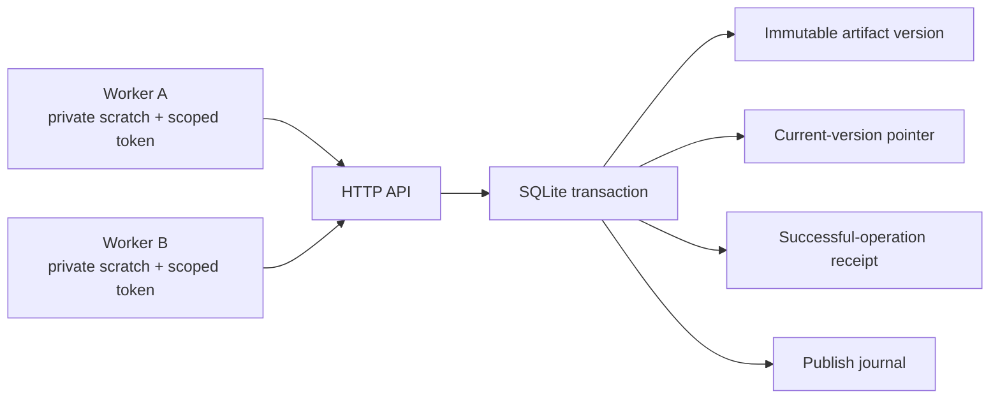

# Architecture

## Guided local onboarding (v0.7.0)

`questlock setup` connects Codex or Claude Code through a complete isolated
candidate, native configuration validation, and a guarded live swap. Claude
Desktop uses a bundled native extension and its own installer. All three routes
use the same private loopback broker and approved request boundary; onboarding
does not enable paid escalation. The first task checks the worker protocol with
no model call. That evidence stays separate from a native client connection.

Follow the [onboarding guide](onboarding.md) for the shortest setup route,
read-only diagnostics and recovery. The diagram has
[editable draw.io source](diagrams/onboarding.drawio).

## Checked deterministic revisions (v0.6.0)

The new Go `revision` path composes with the same scoped publication boundary.
It verifies exact source bytes/digest and declared source checks, applies an
ordered counted literal edit plan, and checks the output before publishing to
`revision/v1/results/<request_digest>`. Each immutable result links source and
output digests plus an optional exact parent key/version. Workers exchange text
through HTTP; they receive neither the SQLite file nor an execution tool.

A revision has no provider or model call. An inline preview is fully offline;
a shared parent read and durable run use broker authentication. Concurrent exact
plans converge on the same immutable result. Digest/count/check failure or
uncertain publication withholds text and stops without fallback. Optional outcome
accounting stays separate from human acceptance. See the [request and failure
contract](checked-revisions.md) and [editable flow](diagrams/checked-revisions.drawio).
[Tagged publication and installed-worker evidence](validation.md#v060-observations--2026-10-16)
are verified for v0.6.0.

Questlock has one trusted broker and multiple independently authenticated workers.
It protects publication of shared UTF-8 artifacts on one host.

Workers never receive the SQLite volume. The server derives the scope from the
token; scope is not accepted as a publication parameter. A worker with a valid
token can read and publish any key in that scope.

## Publication sequence

1. Authenticate the credential and validate the request.
2. Begin an immediate SQLite transaction; recheck that the token is active.
3. Look up the agent's operation ID. If the exact successful request already
   exists, return its original artifact and record a replay against the current head.
4. Reject reuse of a successful operation ID with different request data.
5. Compare `expected_version` to the artifact's current version. A missing key has
   version 0. Record a conflict without changing the artifact if they differ.
6. Insert the new immutable version, update the head, save the successful receipt,
   and journal the acceptance in one transaction. Acknowledge only after commit.

All content is inside SQLite. There is no second filesystem/object-store write
that could get ahead of the metadata transaction. WAL with FULL synchronization
provides the tested process-restart behavior; durability under physical power loss
also depends on filesystem/device guarantees.

## Retry semantics

An operation ID is scoped to an agent and permanently bound to one successful
request. Retrying that exact request returns the same artifact, even when later
versions exist. It does not set the head back to that older version.

The worker must retain the request before sending it if it wants to recover after
a crash. A fresh ID after a lost response can create a second effect. A rejected
request has no successful receipt; corrected work should use a fresh operation ID.

## Model-task coordination

The Go inference Runner builds on this publication boundary to claim exact
model tasks, save results, and coordinate optional shared API budget reservations.
Workers call the selected model provider; the broker owns the database and
receives no provider API key. Job claims and the daily budget ledger use separate
CAS publications, rather than one multi-key transaction.

Version **v0.3.0** adds current-run phase/usage measurements,
optional local content-stream timing, explicit evaluation checks, and a bounded
stdio MCP worker. The worker reads only an approved request inside its declared
workspace and can run at most one explicit escalation after a confirmed complete,
durable, valid-known-usage answer fails the checks. It provides no shell/file-edit
tools or full-session proxy. Hosted escalation requires process permission and
explicit prices/caps; validated local work leaves the paid ledger untouched.

Optional Langfuse receives allowlisted content-free metadata after execution,
without changing durable results or triggering generation retries. Invocation
metrics do not enter job identity; original streaming timing remains historical
response data. See the [runtime architecture and export contract](inference-observability.md),
[delegation boundary](delegation.md), and [local measurements](measurements-v0.3.0.md).

See the [system-boundary and task-lifecycle diagrams](model-architecture.md#editable-architecture-diagrams)
for SVG views and a two-page editable draw.io source. The same guide retains a
Mermaid request-flow view and explains reuse, uncertain outcomes, and settlement.

## Provider routing and runtime caches

The **v0.5.0 experimental release** added two explicit integration
contracts. OpenRouter uses one declared model/provider route, an operator input
reservation bound, and strict native usage partitions. Its requested upstream
fallbacks are disabled; Questlock does not retry uncertain generation. Direct
OpenAI Responses and Anthropic Messages retain their own counting protocols.

Self-hosted SGLang v0.5.20 supports bounded native generation on standalone dense
and HiCache engines. Before looking up a stored answer, the Runner rechecks the
observed runtime identity; a restart or configuration change stops that provider
instance rather than silently adopting a different deployment. HiSparse and PD
prefill/decode engines support configuration inspection only in this release;
the adapter does not supply a PD ingress or bootstrap/transfer orchestration.

The diagram has [editable draw.io source](diagrams/runtime-layers.drawio).
It supplements the historical v0.3/v0.4 runtime and outcome views above.

Questlock's SQLite artifacts contain coordination/results, never runtime KV
tensors. SGLang owns its L1/device, L2/host and optional shared L3 storage.
The configured namespace separates cache keys and is not an ACL. Runtime KV hit
counters stay separate from billable API cache-read/write tokens. Explicitly
self-hosted work skips the paid ledger while retaining hardware and operating
costs outside it. Optional Langfuse runtime metadata has no task text, endpoints,
model paths or credentials. See [contracts and evidence levels](runtime-cache.md).

`model runtime-quest` checks six deterministic HTTP-fixture scenarios without a
GPU. `model runtime-inspect` returns `capabilities`,
`evidence: "runtime_reported_configuration"`, and `gpu_validated: false`.
Neither establishes kernel execution, a HiSparse deployment, or speedup.
Tagged publication is verified; live GPU qualification remains pending.

## Explicit human outcome records

**v0.4.0 experimental** adds an `outcomes` Go package and
CLI on the same scoped artifact boundary. Opted-in worker requests publish
content-free invocation and attempt metadata. Reviewers explicitly record
acceptance, rewriting, rejection, or reopening; check success never implies
human acceptance. Each event links a run ID and uses an expected version and
idempotent event ID. A rewrite clears acceptance until a later explicit
acceptance identifies the final artifact digest.

The diagram has [native editable draw.io source](diagrams/human-outcomes.drawio).
Outcome JSON uses the existing broker and SQLite transactions, with no schema
migration or second database. It is application data inside a cooperative scope;
scope access does not authenticate the reviewer as a person. Apps must obtain
intentional human decisions and maintain their own identity controls.

Every new outcome-artifact version contains the full ledger. Per-ledger run,
event, and byte limits bound its current content but do not cap cumulative
artifact history. Retention, database-growth monitoring, and backups remain
operator responsibilities.

The cohort report includes all its recorded attempts and explicit incremental
review effort, including failed and rejected work, divided by currently accepted
outcomes when all inputs are known. Missing accounting stays unknown; zero
accepted outcomes has no unit-cost result. Each task is read at an observed
version rather than in one atomic cross-task snapshot. Outcome registration is
separate from inference and never triggers generation retries; tracking failure
must be recovered through the metadata receipt path. See
[the feedback guide](outcomes.md) for schema limits, recovery, and cost coverage.
The cohort counts task ID/revision pairs; it does not deduplicate revisions of
one business deliverable. Immutable missing effort cannot be retrospectively
corrected in this release and continues to make the combined metric unknown.

## What grows next

SQLite serializes writers. Each scope's artifact and journal history grow without
retention or quotas. Lists are bounded, but there is no pagination or historical
content endpoint. This is intentionally one host without a scheduler or failover.

Future experiments include task-generation fencing, explicit storage budgets,
retention with preserved retry semantics, and measuring coordination across two
machines. Those are questions, not implemented guarantees.

See [SECURITY.md](../SECURITY.md) for the trusted operator/worker boundary and the
difference between publication controls and an execution sandbox.

`local-agent` is a separate native Codex OSS harness launch: explicit installed
local model, fixed loopback Ollama, private temporary client home, no imported
credentials or active client config writes. Its tool execution uses Codex's
selected sandbox. It does not proxy the hosted desktop chat or replicate model
weights; successful tool use still needs task-specific review.
