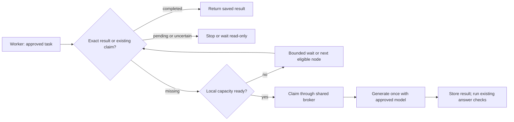

# Busy machine? Keep the work, wait or use a ready worker.

You shouldn't have to close your apps just to let an agent finish a task.
**Questlock** can wait before starting new inference, check whether another
worker has already finished, or try another explicitly configured node. The
approved task, model and quality checks stay the same.

`execution.NewDispatcher` adds this behavior without changing the existing
`execution.Coordinator`. It uses one broker, a finite node list and bounded
waiting. Exact results are checked before capacity admission. A busy machine
can therefore return completed work without loading its model.



```go
gate, err := delegation.NewResourceAdmission(delegation.ReuseAdmissionPolicy{
    // Set this from measured model + context needs, not just free RAM today.
    MinAvailableMemoryBytes: 8 << 30,
    MaxConcurrent: 1,
    MaxWaitMS: 0, // one probe per pass; the dispatcher owns the longer wait
}, admission.SystemSource())
if err != nil { return err }

pool, err := execution.NewDispatcher(broker, []execution.Node{
    {ID: "this-worker", Provider: provider, Admission: gate},
}, execution.DispatchOptions{
    MaxPending: 8,
    MaxWait: 5 * time.Minute,
    PollInterval: time.Second,
    WaitForPeer: true,
})
if err != nil { return err }

result, err := pool.Run(ctx, approvedSpec)
if err != nil { return err }
// Inspect durability and run your existing answer checks before using the text.
```

Here `broker` is an authenticated `inference.Broker`, `provider` is your explicit
self-hosted provider, and `approvedSpec` is the unchanged `inference.Spec`.
The example imports `admission`, `delegation`, and `execution` from this module,
plus Go's `time` package. No provider account or client configuration is changed.
The 8 GiB value is an operator example, not a model-size estimate or an allocation
guarantee. Include weights, context/KV memory and other runtime overhead when
choosing headroom. The old 256 MiB admission default never meant that a large
model would fit.

## What can move to another node?

Only work that **has not started**. A node must return the runner's verified
pre-claim deferral before the dispatcher tries another node. No claim, token
reservation or generation has happened in that path. Each node can use its own
CPU/memory admission callback. The dispatcher doesn't add a model fallback.

Once a worker owns the job, other workers either stop or, with `WaitForPeer`,
poll that same result read-only. They never take over a pending or uncertain
generation. If its artifact disappears, polling still cannot start inference.
An uncertain call may never produce a usable result; the wait ends at its bound.

The wait allowance covers admission and polling. It does not cut short a model
call that was already admitted. The original caller deadline and provider limits
still apply. Dependencies must honor their contexts. At most 64 calls can be
retained by one dispatcher, each with a snapshot bounded to 1 MiB; the default
is eight. Node statistics aggregate counters rather than growing a log on every
poll. Queues and memory estimates belong to that process, not the whole cluster.

## Run workers on separate machines

Use one authoritative HTTPS broker and a different scoped token on each
machine. Run the same approved spec and pinned model contract on workers that
are allowed to execute it. Each worker uses its own local runtime and capacity
gate. A ready worker can win the broker claim while another waits; the waiting
worker can then read the completed exact result.

For master/reviewer roles, use the existing
[multi-machine team setup](local-agent-teams.md#share-work-across-nodes): one
machine can generate the master answer and other machines can review it. Small
machines can coordinate, read results or run explicitly assigned lighter roles.
They don't all need to run the full team.

The dispatcher is a Go helper, not a remote execution server or node-discovery
service. Providers in one dispatcher must retain the same captured runtime
identity. **Questlock** never removes an endpoint, model or digest from identity
to manufacture a cache hit. Different endpoint identities need an explicitly
different execution contract. Share broker HTTP, never the SQLite file.

## A smaller model is an explicit choice

For low-risk drafts, choose a smaller local model in a separately reviewed
profile and measure it on that work. For consequential reuse decisions, keep the
qualified policy and wait or use an eligible worker. More RAM does not prove
better answers, and less RAM must not quietly lower an approval threshold.
Changing a model changes its execution identity; it is not permission to reuse
another model's result or escape an uncertain claim.

Try the [model-free walkthrough](../examples/capacity-dispatch/README.md). It
checks busy-node handoff and exact reuse through independent clients on one
host. It is not a physical multi-host, GPU-throughput or model-quality benchmark.
