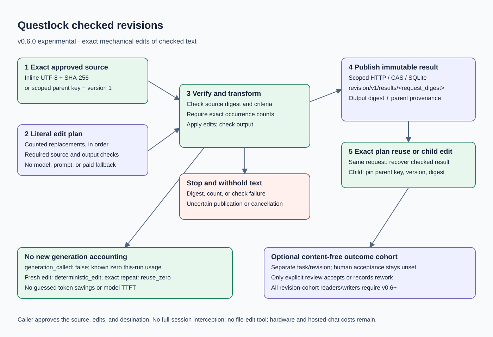

# Checked revisions: change the presentation without generating again

A developer has already reviewed a launch post. The next instruction is “bold
the product name and this mission sentence.” That calls for an exact text edit;
asking another model to rewrite the post adds computation and a chance of changing
its claims. The **v0.6.0 experimental release** adds checked deterministic revisions
alongside the existing model workflow. Tagged artifacts, containers and installed
worker checks are recorded in [validation](validation.md#v060-observations--2026-10-16).

The caller names the exact source bytes, a SHA-256 digest, literal replacements
with expected occurrence counts, and source/output checks. Questlock verifies the
source, applies replacements in order, checks the result, and publishes immutable
provenance through the existing scoped broker. No model or provider is called.
Checks establish the declared criteria; they do not prove general correctness or
human acceptance. This path suits exact formatting and mechanical changes whose
meaning the caller has already reviewed.

## Try three simple and three complex cases

Install the [published release](installation.md), then run the self-contained
quest. From an extracted archive:

```sh
./questlock revise quest
```

From a checkout installation, use `./bin/questlock` instead. To build source,
run `go build -trimpath -o bin/questlock ./cmd/questlock`.

The quest uses real authenticated HTTP and temporary SQLite, without a model,
provider account, API key, GPU, or separately running broker. It cleans up after
itself. These are protocol and correctness scenarios, not model benchmarks.

| Complexity | Scenario | What to inspect |
| --- | --- | --- |
| Simple | Bold a product name while preserving its hashtag | Only explicitly selected prose changes. |
| Simple | Emphasize one exact mission sentence | The complete intended sentence changes exactly once. |
| Simple | Change a literal JSON field | JSON validity and exact expected values still pass. |
| Complex | Revise a published parent, then restart the broker | Exact parent version/digest and child provenance survive. |
| Complex | Change the source, match count, or required checks | The result is withheld; no model fallback runs. |
| Complex | Concurrent edits, exact repeat, and separate scopes | The same edit plan recovers one result; credentials bound access. |

The [complete public requests](../examples/revisions/README.md) contain the exact
source hashes. Preview the product emphasis completely offline:

```sh
./bin/questlock revise plan --request examples/revisions/bold-product.json
```

For durable publication, start the [local broker](model-workflows.md#run-through-a-shared-broker),
use a credential in the intended scope, and run the same request:

```sh
export QUESTLOCK_TOKEN_FILE="/absolute/path/to/private/worker.token"
./bin/questlock revise run --request examples/revisions/bold-product.json \
  --broker http://127.0.0.1:8080
```

An inline `plan` needs no token and makes no broker or model call. A plan that
references a shared parent needs authenticated broker access. `run` always uses
the broker. Both accept `--timeout` (default `2m`, maximum `10m`). Treat plans and
results as sensitive text. Neither the CLI nor MCP edits your files; the calling
application deliberately applies the checked returned text to its destination.

## Request contract

The strict JSON request has no provider, model, prompt, price, or fallback field.
Unknown fields and trailing content are rejected. Use the examples as runnable
fixtures and update both the source digest and checks for your approved text.

| Field | Contract |
| --- | --- |
| `schema` | `1`. |
| `task`, `revision` | Explicit task identity; use a separate revision for this edited artifact. |
| `source.text` | Inline UTF-8 source, or omit it when referencing a shared parent. |
| `source.key`, `source.version` | Together select one exact published revision result in the same broker scope, with immutable version `1`. Never a mutable head or arbitrary broker artifact. |
| `source.sha256` | Required lowercase SHA-256 of the exact source UTF-8 bytes, for both source forms. |
| `edits` | 1–32 sequential literal replacements, each with nonempty `old`, a different `new` string, and `expected_matches` in 1–4,096. `new` may be empty for deletion. No regular expressions or language interpretation. |
| `source_checks` | Required 1–64 declared checks evaluated before edits. |
| `checks` | Required 1–64 declared checks evaluated on the output. |
| `track_outcome` | Optional content-free invocation accounting; it never establishes human acceptance. |

Sources and output contain 1–262,144 bytes of UTF-8 each; each `old` and `new` literal is
limited to 16 KiB. Match counts refer to the current text at that step, so an
earlier edit can change what a later edit matches. There is no fuzzy matching,
case folding, automatic escaping, global semantic cache, or reasoning repair.
The check kinds are the same bounded `json_valid`, `json_equals`, `contains`, and
`not_contains` criteria used by the model worker.

To keep a LinkedIn hashtag searchable, replace complete prose occurrences such
as `Questlock coordinates` and `Questlock reuses` rather than every substring
`Questlock`. The example emits Unicode bold letters so emphasis survives a plain
text paste. An exact literal check cannot judge tone, factual support, or whether
Unicode styling is appropriate for your audience; the caller retains that review.

## Shared output, provenance, and uncertainty

Successful results use a content-addressed key
`revision/v1/results/<request_digest>` in the authenticated scope. Repeating the
same approved edit plan can reuse that exact result. Every invocation still
rechecks the source, applies the bounded edits, and validates the result before
confirming the immutable publication. A different source, digest,
ordered edit list, task revision, or declared checks gives a different identity;
similar wording does not qualify. Accounting opt-in is outside that identity.
No model-result TTL or semantic equivalence is
substituted for the exact request identity.

A child may select that key with its exact broker version and output digest.
The saved record links the request, source digest/reference, output digest, and
checks. It does not overwrite the parent or migrate human acceptance to the
child. Broker scope credentials remain the access boundary; a digest is an
identity check, not permission or proof that the source was correct. Inline text
can come from a prior model result or a human draft; the caller supplies and
checks those exact bytes rather than treating arbitrary storage as trusted text.

Source drift, wrong match counts, failed checks, cancellation, and uncertain
publication stop the revision and withhold its text. Inspect the exact stored
request/result after uncertainty; do not change the task revision just to force
a second attempt. No local or paid generation fallback follows a failed edit.
For further reasoning or fallback, the caller constructs and reviews a separate
bounded request and quality policy under the user's existing authorization.



The [draw.io source](diagrams/checked-revisions.drawio) uses editable native boxes,
labels, and arrows. It complements the existing
[runtime layers](diagrams/runtime-layers.drawio) and
[human outcome feedback](diagrams/human-outcomes.drawio).

## Accounting and human review

A completed fresh deterministic revision reports `generation_called: false`,
known zero `this_run_usage`, provider cost `0`, and cost basis
`deterministic_edit`. This is new work performed without a model call, including
on the first edit. An exact repeat reports reuse with cost basis `reuse_zero`.
Historical source-generation costs stay
historical; the revision neither charges them again nor guesses how many tokens
some hypothetical rewrite would have used. There is no new model TTFT to compare.
CPU, storage, operator work, and the surrounding hosted assistant still cost
resources and remain outside this provider-token statement.

With `track_outcome: true`, a separate task/revision cohort records the edit
invocation. Require a recorded receipt for accounting coverage. If tracking
fails, recover its exact returned record; never invoke a model to repair
accounting. Checks and assistant inspection leave human acceptance unset.
Only explicit operator feedback accepts the edited artifact or records rework.

All readers/writers handling revision outcome cohorts must be v0.6.0 or newer:
older outcome clients do not understand the new `deterministic_edit` cost basis.
Keep these cohorts separate from older generation cohorts during an upgrade.
Missing effort or acceptance still leaves cost per accepted task unknown under
the [existing outcome rules](outcomes.md).

## Codex, Claude, and OpenRouter

The installed v0.6 skill prefers `revise` for exact mechanical edits, exact model
result reuse for the same valid snapshot, and a bounded local model only when
the task requires new text generation. The caller still investigates, chooses
the source, approves the precise edits, and reviews the result.

`questlock_revise` reads only the named approved revision request inside the MCP
worker workspace. It shares the existing single-active-task admission,
cancellation, file-size, and path-confinement boundary with `questlock_delegate`.
It has no file-edit, shell, or discovery tools. An older running MCP process
needs its normal controlled restart to expose the new tool; skill installation
alone does not change that running process or client model configuration.

For a default across local Codex project and standalone chats, opt in through
Codex's supported global instruction mechanisms after installing the skill.
Prefer exact edits/reuse before suitable checked local inference, preserve
caller judgment and explicit human acceptance, and use stable project/use-case
task IDs across chats. [Setup and fresh-session validation](installation.md#optional-default-for-local-codex-chats)
are separate from binary installation. This is a routing preference for eligible
work, not interception of every conversation or a change to hosted allowances.

OpenRouter continues to provide model access, routing, and provider caching.
Questlock's companion path handles an exact downstream edit before asking for
another generation. These are additive tools for work explicitly routed through
them; they do not intercept all chats, bypass credit limits, or make arbitrary
reasoning changes free.
