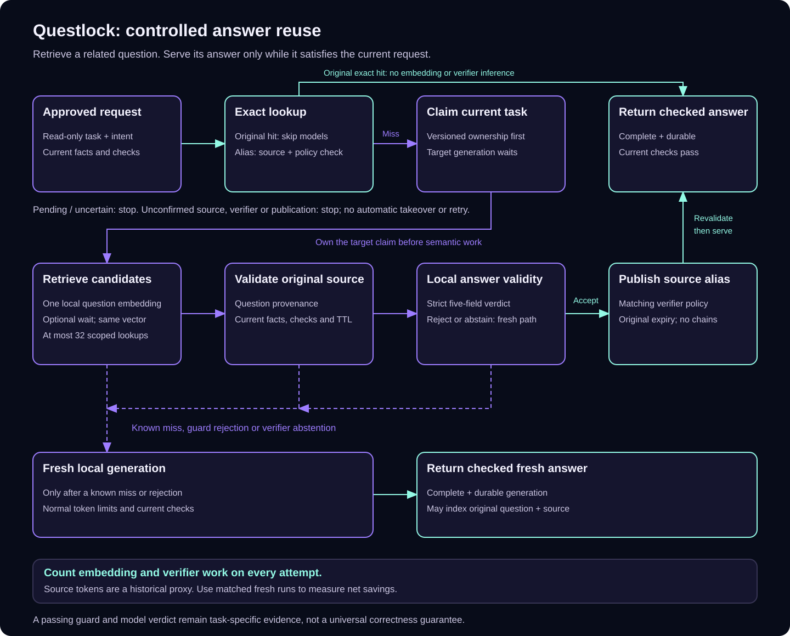

# Controlled answer reuse

A customer asks a policy question that another agent answered yesterday. The
wording has changed; the policy and customer facts may have changed too.
Questlock can retrieve the related question, then check whether its saved answer
still satisfies the current request before serving it.

This gives cooperating agents shared memory with a publication boundary. It
serves checked text for explicitly read-only tasks. The caller must supply the
current evidence, constraints and deterministic checks. A related question, a
high similarity score or a passing format check is insufficient on its own.



[Editable draw.io source](diagrams/controlled-reuse.drawio).

## Opt in for a bounded task

Add a `semantic_reuse` object to an approved [delegation request](delegation.md).
Keep one explicit local tier and a positive answer reuse TTL. Controlled reuse
rejects an escalation tier or a simultaneous `semantic_shadow` policy.

This is the additional request field; the surrounding task, tier and checks
remain required:

```json
{
  "semantic_reuse": {
    "mode": "controlled",
    "read_only": true,
    "intent": "explain-customer-password-reset",
    "family": "support-faq",
    "domain": "customer-support",
    "evidence_revision": "password-policy-1",
    "bindings": {
      "account_type": "customer",
      "email_access": "available"
    },
    "embedding_model": "all-minilm",
    "verifier_model": "qwen3.5:4b"
  }
}
```

The model names are examples, not a quality recommendation. Install and qualify
local weights separately. The embedding and verifier adapters use an explicitly
configured literal-loopback Ollama endpoint. They do not download missing models
or fall back to a hosted provider. Keep paid fallback disabled for this path.

`read_only: true` is a required declaration about the task. Reusing a text answer
does not perform a refund, reset an account, grant access, send a message or
replay any other external action. The surrounding agent keeps responsibility
for its tools and permissions.

Use `intent` for the particular answer sought. Put relevant business variables
in `bindings`, such as account type, order, commit or incident period. Preserve
the approved evidence revision and task revision only while their facts remain
valid; change them when facts change. Omitting a fact from the bindings does not
make that fact irrelevant.

| Setting | Default | Maximum |
| --- | ---: | ---: |
| `timeout_ms` for controlled resolution | 60,000 | 60,000 |
| `verifier_max_input_tokens` | 8,192 | 32,768 |
| `verifier_max_output_tokens` | 128 | 512 |
| `verifier_timeout_ms` | 30,000 | 120,000 |
| `max_input_bytes` for each question | 8,192 | 32,768 |
| `wait_for_candidate_ms` | 0 | 30,000 |

Earlier invocation deadlines still apply. The verifier input includes both
questions, instructions, supplied context and cached answer, so a question that
fits the embedding limit can still exceed the verifier budget. The existing
[bounded search and entry limits](semantic-shadow.md#storage-and-resource-limits)
also apply. `min_similarity` filters retrieval; it is not a validity confidence
or a promised precision.

Set `wait_for_candidate_ms` when a related answer may be finishing in another
agent. After an empty search, Questlock can wait before target generation and
repeat the same vector query, using the question embedding already computed.
The initial search and repeats total at most 32 lookups. The wait and earlier
invocation deadline bound the delay. Default zero keeps the immediate-miss
behavior. Waiting does not interrupt another agent, clear its claim or guarantee
that a reusable answer will appear.

Local resource pressure can skip this optional reuse path and continue normal
fresh generation. The main generation path still needs its own resource
admission policy; the reuse gate does not throttle all model work.

The observation's `resource_admission` explains an actual probe: stale or
unavailable sample, memory pressure, insufficient memory, CPU stall, load, or
`ready`. It includes measured available bytes when known. It does not expose
command output or local paths. An exact hit makes no optional probe, so it has
no new resource sample. A percentage of free memory alone does not override
the operating system's pressure warning.

## Don't spend more checking than answering

A verifier reads the evidence and old answer before making a decision. For a
short question, that can cost more tokens than generating fresh. Measure the
whole path, including embeddings, misses and failed checks.

When your application already has a reviewed list of equivalent questions,
[approved question forms](approved-questions.md) avoid that check entirely.
They prepare a normal exact request. Unknown sentences are not added to the list
by a similarity score or another model.

Shared verifier experiments are available only in the explicit diagnostic
command described below. They do not serve application answers or replace the
existing standalone verifier. A shorter verdict failed scope and grounding
checks during qualification; reducing token counts was not enough to release it.

## How a request is resolved

1. Read the exact task state first. A valid original answer skips embedding and
   verifier inference. Pending, uncertain, incomplete and breached-budget states
   retain their existing stop behavior.
2. On an eligible miss, win the current task's versioned claim before doing
   semantic work. Other workers cannot use this path to cancel the owner or
   clear its pending or uncertain outcome. Target token counting and generation
   wait until candidate resolution finishes.
3. Embed the current question locally and search a bounded set of scoped
   entries. The partition binds family, domain, evidence revision, business
   bindings, intent, task/revision, instructions, context, checks, tier and runtime.
4. Check the original question's provenance against its request and source job.
   Require the current source version, content/output hashes, complete response,
   known bounded original usage and unexpired reuse window. Old shadow entries
   without question provenance cannot serve answers.
5. Compare explicit protected terms: quantities, dates, code identifiers, URLs,
   quoted text, negation, symbolic operators and quantity units. The existing
   conservative guard also rejects a different extraction order. These checks
   cannot establish who does what or which amount belongs to whom; the verifier
   still needs the complete request and evidence. Rerun current deterministic
   answer checks. A harmless paraphrase can be rejected, including one with an
   unmatched lexical negation.
6. Ask the local verifier whether the unchanged cached answer satisfies the
   current question and evidence. A strict verdict must say `accept` and affirm
   `same_intent`, `same_facts`, `same_constraints` and `answer_supported`.
   A model's confidence number is not part of this contract.
7. Revalidate the source and publish a durable reference for the current task
   before returning the answer. A known miss, guard failure, rejection or
   abstention can proceed to normal bounded local generation. Unconfirmed source,
   verifier or publication outcomes stop the invocation without automatic retry.

An unconfirmed verifier leaves the target uncertain even if the target itself
never generated. Selecting a different candidate on a later call cannot bypass
that claim. Known complete malformed verdicts abstain and retain their usage;
they never authorize reuse.

The durable reference is an alias of one original generated answer. Replaying it
requires the same verifier policy and a fresh source validation. It inherits the
source's original creation time and expiry; reading it does not refresh the
window. Aliases are not indexed as new sources, and an alias cannot point to
another alias. The request still has to pass its current output checks.

Lexical guards cannot discover every changed fact in free-form prose. A local
verifier can also approve an incorrect answer. Qualification must test the
particular question families and evidence the application uses; this is not a
universal correctness guarantee or evidence of human acceptance.

## Share memory without sharing the database

Go callers use `delegation.Router` with a `ControlledReuser`, a scoped broker,
an embedding factory and a verifier factory. This function wires the actual
local adapters around an existing approved request and runner factory:

```go
package example

import (
    "context"

    "github.com/spfuzzylink/questlock/admission"
    "github.com/spfuzzylink/questlock/client"
    "github.com/spfuzzylink/questlock/delegation"
    "github.com/spfuzzylink/questlock/semantic"
)

func runControlled(ctx context.Context, broker *client.Client,
    approved delegation.Request, factory delegation.RunnerFactory,
) (delegation.Result, error) {
    const localURL = "http://127.0.0.1:11434"
    reuse := &delegation.ControlledReuser{
        Broker: broker, Index: broker, Resources: admission.SystemSource(),
        EmbedderFactory: func(ctx context.Context, c semantic.Config) (semantic.Embedder, error) {
            return semantic.NewOllamaEmbedderContext(ctx, localURL, c.EmbeddingModel, c.MaxInputBytes)
        },
        VerifierFactory: func(ctx context.Context, c semantic.ReuseConfig) (semantic.Verifier, error) {
            v, err := delegation.NewLocalVerifier(ctx, broker, localURL, c)
            if err != nil {
                return nil, err
            }
            v.DailyTokenBudget = approved.Policy.Local.Spec.DailyTokenBudget
            return v, nil
        },
    }
    router := delegation.Router{Factory: factory, Reuse: reuse}
    return router.Run(ctx, approved)
}
```

The approved request must explicitly supply `SemanticReuse`. The factory returns
an `inference.Runner` or a wrapper forwarding its reuse methods. The underlying
`inference.Runner.RunWithResolver` owns the exact lookup and claim order;
`Lookup` reads eligible original generations without generating. Wrappers must
forward those methods and `RuntimeIdentity`. Existing calls to `Run` keep their
ordinary behavior.

Agent processes on one or several machines can use the same authenticated
broker API and scope. Each machine owns its local model runtime and resource
admission; only the authoritative broker owns SQLite. This does not supply
distributed placement, worker takeover, replication or broker failover. Two
clients or isolated nodes on one host are not a physical multi-machine benchmark.

Source questions, answers, vectors and verifier receipts are sensitive task data.
They share the existing scope and trusted-host boundary. A cold source can be
read through normal storage validation while its original reuse window remains
valid. An expired historical answer may be useful as a reference for a new task;
its availability in cold storage does not make it eligible to serve as today's
answer. See [storage recovery](storage-retention.md) and [security](../SECURITY.md).

## Measure correctness and the work saved

Run the six deterministic protocol scenarios without weights or a provider
account:

```sh
questlock semantic reuse-quest
```

To evaluate the frozen challenge with already installed local embeddings and a
local verifier, explicitly opt into model calls:

```sh
questlock semantic evaluate --live \
  --suite examples/semantic/controlled-evaluation.json \
  --embedding-model all-minilm --verifier-model qwen3.5:4b \
  --ollama-url http://127.0.0.1:11434 --timeout 20m
```

Use `--batch-size 2` to evaluate the typed shared verifier on compatible pairs
within each source case. Retrieval and protected terms still run for every
question. Grouping uses suite order and compatibility, never the expected label;
a singleton tail is withheld. The JSON retains all pairs and accounts shared
model work once in `batch_verification_work`. It is a verifier diagnostic, not
a default-serving or fresh-answer benchmark. Here, `served` means the checker
would approve the supplied fixture answer; no application answer is published.
[Retained qualification results](reuse-efficiency-validation-v0.16.0.md) include
false acceptances and the policies withheld from serving.

The first command uses scripted providers. The second uses supplied source
answers, real local embeddings and durable verifier inference; it generates no
fresh answer baseline and measures no answer-generation saving. A completed
report means execution finished, not that the population met a quality target.

Choose a labeled question population before evaluating it. A false acceptance
means a cached answer was served although it did not satisfy the current
request. Report precision among served answers, recall among eligible answers,
coverage across all questions, false acceptances and abstentions, with sample
counts and confidence intervals. Report each family as well as the combined
population; a high aggregate score can hide a weak family.

The 90–98% precision range is a qualification target, not a cosine cutoff or the
verifier's self-score. Report the observed fraction and a binomial confidence
interval, such as Wilson's 95% interval. A small perfect sample does not establish
the lower bound, and changing the corpus or policy requires a new evaluation.

The [frozen challenge corpus](../examples/semantic/controlled-evaluation.json)
has 72 authored variants: 36 eligible and 36 ineligible across support FAQ,
onboarding, incident handoff, release readiness, refunds and shared-broker
lifecycle. It was authored independently before inspecting the verifier prompt.
It is a declared synthetic population, not a universal held-out benchmark.
Protocol fixtures establish coordination behavior separately from live model
quality and a person's acceptance.

Count embedding and verifier work on misses, rejections and failures too. Keep
their known tokens and latency separate from target answer generation. A served
answer has no new target-generation usage, but its verifier may still have run.
Unknown usage stays unknown. Source generation tokens are a historical proxy;
they do not measure how many tokens a fresh answer would have used now.

For requests with `track_outcome`, the worker records verifier inference as
auxiliary `outcomes.Run.VerificationWork` in JSON `verification_work`. Its usage,
failures and missing observations contribute to cohort accounting separately
from target attempts. It cannot establish target completion or human acceptance.
Embedding usage remains in the semantic observation rather than this inference
ledger. Go callers use the existing explicit outcome-registration functions.

Use v0.15+ for every worker and outcome reader sharing a controlled-reuse cohort.
Older strict readers cannot read a run containing the new `verification_work`
field. Upgrade those participants before recording controlled verification work;
ordinary requests omit the field when there is no verifier work.

Measure net savings against matched fresh local runs, including embedding,
verifier, setup and publication overhead, failures and human rework. For a short
answer, validation can take more work than generating it again. A local run can
have $0 provider API charges while consuming machine time, memory and power.
These controls cover work routed through Questlock; the surrounding hosted chat
keeps its own costs and limits.

The separate [shadow observer](semantic-shadow.md) remains diagnostic: it runs
after fresh checked generation and serves no candidate answer. Use it when the
goal is to inspect retrieval opportunities before enabling controlled serving.

[Measured development challenge and six live workflows](controlled-reuse-validation-v0.15.0.md)
retain misses, overhead and factual failures. This release is an experimental
opt-in; the short-answer sample demonstrates no net token saving for first-time
paraphrases. Exact reuse remains the lowest-overhead path.
