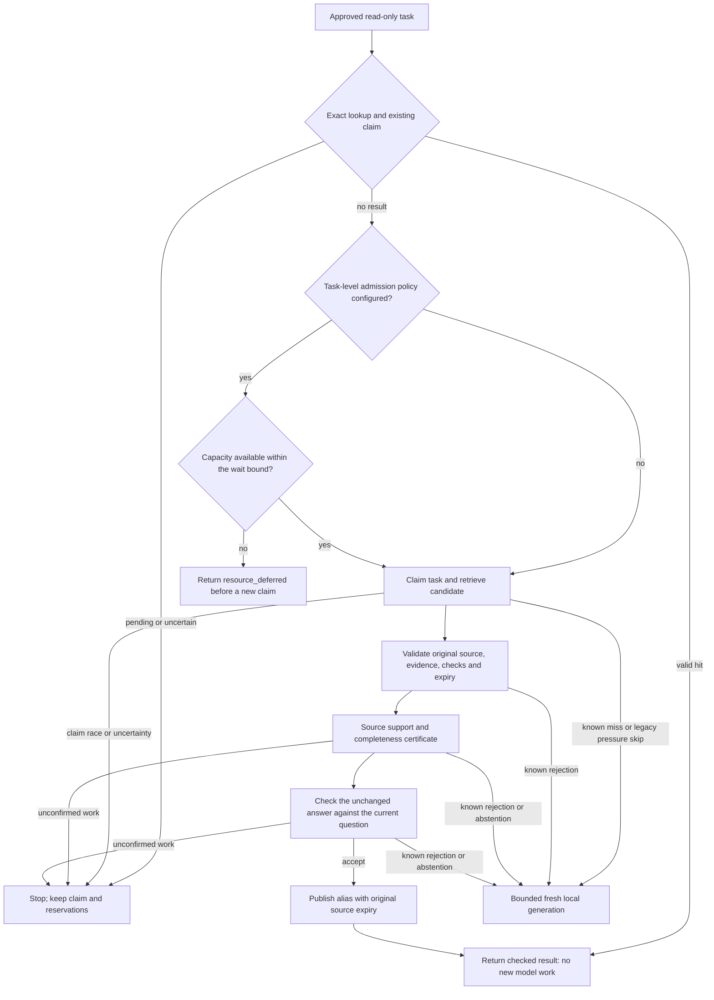

# Check the answer once. Check each new question separately.

**Release gate: not qualified.** The current mixed-model development pilot
completed all nine consumed cases with known usage: 4 true positives, 2 false
negatives, 2 false positives and 1 true negative. The larger regression rounds
were stopped. The unsafe acceptances involved reversed question polarity and
incomplete coverage of a broader permissions request. Configurable resource
admission does not resolve those semantic failures. Keep this candidate out of
production; the published policy is unchanged.

Older development tables use their original labels and configurations. The
previous 69/72 result included a reversed-polarity request later corrected to a
negative label, so that aggregate does not establish current safety or recall.
The format failures and unsupported-source checks remain historical evidence,
not fresh qualification of this candidate.

Someone asks the same thing in different words. We want the saved answer back,
without quietly borrowing an answer to a different question.

The experimental `factorized-v1` policy splits that decision into two local
checks. First, a source check reads the original question, evidence and saved
answer. It must confirm that the answer is supported **and complete**. Then an
applicability check reads that exact answer, the new request and the same evidence.
It asks whether the unchanged answer actually satisfies the request. Different
wording, or a narrower question, can be fine; changed facts or missing detail
are not. A prose answer does not become JSON just because the facts match.

No question list is required. Both checks keep the full approved background;
a context hash or a generated summary cannot replace it. The second check sees
the original question and full saved answer, including its keys, values and layout. That costs input
tokens, but a coarse label such as “JSON object” cannot tell us whether the keys
match. The source check can be cached; net savings still need measurement.
The receipt stage named `equivalence` records this applicability check. Intent
labels still partition work and bind its identity; they are omitted from the
model input so a source label cannot define what the new question means.
The verifier uses native system/user separation rather than wrapping its data
record in another serialized request. All evidence and decoder-schema bytes
still count against preflight and runtime limits.

This is still an experimental verifier. Qualify it on your own work before
serving its results. A valid JSON verdict or high embedding similarity does not
prove that a model understood the question.



The source certificate may already exist. That saves its model call, but it
doesn't remove current source validation or the new question's applicability
check. Unconfirmed source reads or publication also stop; the fresh path cannot
be used to escape an uncertain result.

## Opt in explicitly

Add these settings to an otherwise complete [controlled reuse request](controlled-reuse.md):

```json
{
  "verifier_policy": "factorized-v1",
  "verifier_model": "qwen3.5:9b",
  "verifier_max_input_tokens": 16384,
  "verifier_max_output_tokens": 128,
  "verifier_timeout_ms": 60000
}
```

The model is an example, not a quality recommendation. Install weights separately.
The worker selects the requested policy. Go callers supply
`delegation.NewFactorizedVerifier` from their `ControlledReuser.VerifierFactory`
and set its `DailyTokenBudget` to the approved task's shared budget, just as for
`NewLocalVerifier`. Omitting `verifier_policy` keeps the standalone verifier.
Older workers must reject unsupported settings rather than silently ignoring them.

The two stages default to half the declared input and output allowance, under one
verifier deadline. Optional smaller stage input caps are described below. Their actual usage and durable receipts appear separately in
`verification.work`. Outcome accounting flattens those stages into verifier work;
the combined decision receipt is not another inference call. An unconfirmed
inference outcome stops the target without automatic retry or paid fallback. A complete
rejection or `unknown` verdict with confirmed usage is a known abstention; the
approved workflow may continue to fresh bounded local generation.

Some installed models need a reasoning budget to check a saved answer properly.
Set `verifier_source_think: true` to allow reasoning in the source check only.
This opt-in defaults to a shared 4,096-token output allowance and a 120-second
deadline; each stage gets half the token allowance. Smaller explicit caps still
apply. The question comparison does not enable reasoning. Count the source's
reasoning tokens too: hiding its reasoning text does not make that work free.
Without this setting, the existing smaller limits stay unchanged. A larger
budget is an option to test, not evidence of better answers or lower cost.

## Give busy hardware time to catch up

Memory headroom, concurrency and waiting time are deployment choices. A laptop
can admit one job at a time; a larger machine can allow more. The answer still
has to pass the same checks.

Admission policy is operator configuration, not a delegation request JSON field.
Go callers can load it with `delegation.LoadReuseAdmissionPolicy(reader)` and set
`ControlledReuser.AdmissionPolicy` before the first request. For a verifier used on its own, build a shared
callback with `delegation.NewResourceAdmission` and assign it to
`FactorizedVerifier.Admission`. Use one admission layer per call path: acquiring
the same lease again inside an admitted job can fill its own concurrency limit.

A small runtime policy looks like this:

```json
{
  "min_available_memory_bytes": 268435456,
  "max_concurrent": 1,
  "max_queued": 8,
  "max_wait_ms": 120000
}
```

The evaluation CLI accepts this file with `--resource-policy PATH`. Omitted
fields use the documented defaults in `ReuseAdmissionPolicy`; zero queue slots
means no waiting queue, and a zero wait means one immediate resource sample.
Set the policy before the reuser's first request. Create a new reuser instance
to change it; current capacity samples still change on every admission probe.
More memory headroom leaves less room for model work. More concurrency can
improve throughput when the hardware can carry it.
High memory pressure requires an explicit opt-in. Critical pressure, unknown
samples and invalid samples still defer new admission.

With this policy enabled, exact hits and existing claim fences are checked
first. New work waits for capacity before claiming the task. If its bounded wait
expires, it returns `resource_deferred`; it does not start fresh generation or
count as a failed answer-quality check. A proven pre-claim deferral can be
rescheduled with the same task identity after capacity returns; no revision bump
is needed. Unknown execution remains fenced. Bounded waiting promises neither
admission nor eventual completion. Once admitted, work keeps its caller
deadline. A later resource sample does not cancel it through this admission
policy. Resource observations and wait time are reported separately from model
verdicts, including any source-check work already completed.

These queue and concurrency limits belong to one reuser process. They are not
cluster memory reservations or a guarantee against an out-of-memory failure.
Omitting the policy preserves the existing behavior, which may skip optional
semantic reuse under pressure and continue to bounded fresh generation.

## Choose the two verifier stages separately

By default, both stages use `verifier_model`. An optional
`verifier_pair_model` selects a different installed local model for the new
question's applicability check. Optional `verifier_source_max_input_tokens`
and `verifier_pair_max_input_tokens` reduce each stage's input cap. Each cap
must fit within half the total verifier input allowance; omitted caps keep that
half. A smaller cap must still fit the complete rendered input, including the
schema and model instructions. An over-budget request stops before generation;
the verifier does not trim evidence to make it fit. These settings enable no
fallback route.

Explicit stage model or input-cap settings add declared model and runtime
identity attribution to the stage usage. Default omitted fields stay omitted.
Changing the pair
model changes the decision identity. Keep the two stages separate when reporting
token savings: a token from one model's tokenizer is not a common unit of work
across models. Aggregate counts are reservation-accounting sums, not normalized
savings. Measure the complete attempt against a matched fresh baseline.

When new stage model/runtime or pre-claim deferral fields are recorded, every
worker and strict outcome reader in that cohort must use v0.17 or newer. Older
readers can reject those fields; use a compatible cohort rather than silently
dropping accounting. Legacy controlled work with these fields omitted retains
its existing compatibility requirements.

## What gets reused

The source certificate binds the original job version, content and output hashes,
original request, approved evidence, verifier policy and installed runtime.
Its task result can be reused for up to one hour. Reading it does not extend that
window. Each question decision also binds its source certificate, the exact answer and
current request.
The final answer alias still inherits the original answer's expiry, even when the
certificate remains available longer.

Exact task lookup stays first. An exact hit skips embeddings and both verifier
stages. Pending and uncertain claims retain their existing fences. This option
adds no action replay, source promotion, weight training or automatic cancellation
of another agent.

The default verifier retains its conservative literal guards. This policy adds
rejection-only checks for recognized numeric-only, JSON, CSV/TSV, Markdown
table, prose and no-JSON requests. It checks the actual saved representation, not a format label,
and never converts an answer. Unrecognized wording still needs the local
verifier; these checks cannot establish facts, complete coverage or meaning.
They can conservatively withhold an otherwise usable answer. Changed numbers,
identifiers, roles and conditions remain the contextual verifier’s job. Keep
independent hard negatives in the workload.

Explicit language changes get a separate check. An English response cannot be
reused unchanged when the new request asks for Spanish. The screen recognizes
English, Spanish and French directives and shared instruction defaults; other
explicit languages or conflicting directives withhold reuse. It does not detect
the actual answer's language. Quoted examples are data, and passing this screen
still leaves the full decision to the local verifier.

There is also a rejection-only screen for statistical measures in saved answers.
An answer saying “average latency below 250 ms” cannot borrow evidence that only
establishes “p95 latency below 250 ms.” Recognized measures near numbers must
appear in the approved context or bindings; mean/average and median/p50 count as
aliases. Questions and instructions supply no evidence for this screen. It does
not check which object a measurement belongs to, prove its value, or validate
every unit, denominator or time window. It can withhold valid derived statistics.
Both model checks remain required after the screen passes.

## Measure the whole attempt

The first new wording pays for source certification and question comparison.
Later new wordings may reuse the certificate. Exact repeats of a resolved task
need neither. Count all three paths separately, including embeddings, misses,
failed answers and uncertain work. For short answers, checking can still cost more
than answering fresh. There is no automatic token-saving claim for this option.

The [six-case measurement](../examples/paraphrase-reuse/README.md) runs fresh
sources, two new wordings per source, exact repeats and optional fresh baselines.
Those examples exercise the integration; they do not establish general language
accuracy. Freeze a separate population before evaluation, test changed facts and
constraints, and report precision, recall and coverage by use case.

## Where FreeToken fits

[FreeToken](https://github.com/FlashML-org/FreeToken) serves open-weight models
on local hardware. Its [current installation requirements](https://github.com/FlashML-org/FreeToken/blob/main/docs/install.md)
are Linux x86-64 with an NVIDIA GPU; this is not an Apple Silicon backend.
Its [OpenAI and Anthropic APIs](https://github.com/FlashML-org/FreeToken/blob/main/docs/quickstart.md)
make it worth assessing as a separate provider. This verifier currently uses
Ollama. API compatibility alone does not validate token preflight, bounded output,
usage accounting, runtime identity or uncertain-call recovery. We have not added
a FreeToken adapter or measured its speed or reuse quality. A faster runtime
still needs the same answer-validity tests.
