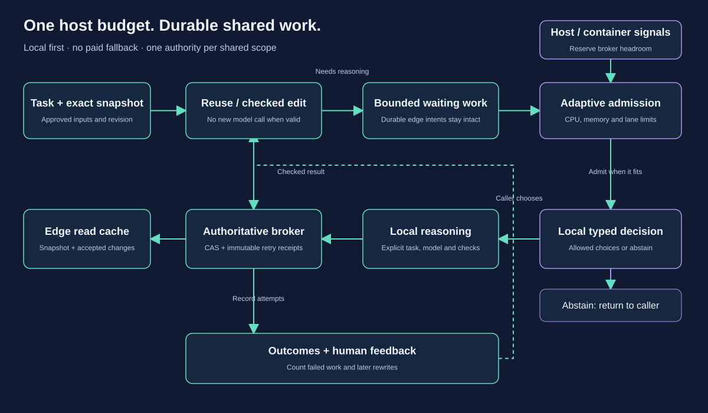

# One local control loop

Spend local capacity on work that still needs doing. Keep accepted results and
unfinished writes durable so the next worker does not start from scratch.

[Editable draw.io source](diagrams/local-coordination.drawio).

## The same policy across the services

Start with the exact task snapshot. Reuse a still-valid result or apply a checked
literal revision when that is enough. Changed facts require a new revision.
Neither path needs a model call. Shared artifacts remain scoped to authenticated
credentials; a cache hit is not permission to replay an external action.

For new local work, sample effective CPU capacity and available memory, leave
headroom for the broker and system, then decide how much work to admit. The
opt-in controller bounds both waiting work and active workers. Resource pressure
can lower admission immediately; recovery raises it cautiously. A configured
hard ceiling remains even when the machine looks idle. Existing queued work is
retained when the dynamic limit falls.

The same admission interface can wrap local decisions, a local reasoning task,
or an edge push/pull operation. These tasks have different reservations and
concurrency limits. A shared model defaults to one active worker: several
callers do not create several independent GPUs. Reservations estimate capacity;
they do not allocate cores, impose OS memory limits or make third-party model
servers obey them. Container/runtime limits remain the enforcement boundary.

Keep the broker responsive. Persistence, receipt recovery and health checks
must not wait behind a long inference queue. The controller reserves headroom;
it is opt-in and does not silently rewrite the existing broker or MCP worker's
admission rules. Each host manages its own resources. The first release does
not implement a distributed resource scheduler or an atomic budget shared by
separate scheduler processes.

## Decisions, reasoning and accepted writes

The optional TypeSafe System One Adapter asks an installed Ollama model for a
choice from an allowed set. Go checks the response and may abstain. A score is
not calibrated confidence, human acceptance or authority to execute a write.
This is a local alternative using the official adapter, not self-hosted Jev
weights. A caller can deliberately send a suitable task to the existing bounded
local worker or native local Codex loop when more reasoning is needed.

The authoritative broker still owns CAS, immutable versions and operation-ID
receipts. An edge commits a complete immutable publish intent locally before
sending it. Offline queueing is not upstream acceptance. An uncertain write
keeps the same operation ID and request; conflicts require an explicit decision.
Pulling a consistent snapshot or accepted changes updates a separate read cache.
An old retry receipt must never replace a newer cached head.

Only the broker owns its server SQLite file. Each edge owns a separate private
SQLite directory. Use authenticated HTTP, and HTTPS between hosts; do not share
live SQLite files over a network filesystem or run cloned databases as competing
authorities. Raw artifact content crosses the configured synchronization endpoint.

## What pressure is allowed to change

Admission, worker count and when the next bounded operation starts can change.
Required context, request identity, accepted versions and a durable intent's
bytes cannot silently change. A task that does not fit must wait or fail
explicitly. A timeout is not permission to rerun inference or switch providers.
The adaptive queue is not a replacement for the durable edge journal; callers
must retain their source of work across process failure.

Operators choose their own cost and resource policy. An explicit local-only
preset uses checked work, exact reuse and installed local inference without
paid fallback. Hardware and electricity are supplied by the operator. Hosted
coordination still uses its normal allowance; measure comparable quality,
failed attempts and human rework before claiming whole-workflow savings.
[Personal policy examples](../examples/preferences/README.md) are opt-in data,
not instructions imposed on forks or automatically loaded from a checkout.

[Shared-state protocol](second-gate.md) · [Existing bounded workers](delegation.md) ·
[Local reasoning loop](onboarding.md) · [Human outcomes](outcomes.md)
