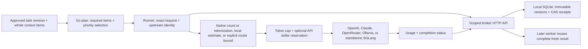

# Model cost-control architecture: what, why, how

## v0.6.0: avoid generation for exact edits

The next layer is a checked `revision` operation beside the model Runner. The
caller already has reviewed text and supplies exact literal changes. Source
hashes, counted replacements, source/output checks and immutable scoped parent
references bound that mechanical operation. No model adapter or provider budget
reservation is involved. A fresh edit reports `deterministic_edit`, an exact
repeat `reuse_zero`; neither invents avoided token counts or a model TTFT.

This extends the OpenRouter companion workflow: route through OpenRouter when a
model is needed, and use Questlock's deterministic path when an exact edit is
sufficient. It does not select models automatically or intercept surrounding
chats. See [checked revisions](checked-revisions.md), the [SVG flow](diagrams/checked-revisions.svg),
and its [editable draw.io source](diagrams/checked-revisions.drawio).
The [published v0.6.0 artifacts](validation.md#v060-observations--2026-10-16)
are verified; v0.5.0 and older releases remain available unchanged.

The provider layers introduced in **v0.5.0** add OpenRouter and explicit SGLang
runtime/cache contracts to bounded tasks and human feedback. They remain available
in v0.6.0. Tagged publication is verified; live GPU qualification remains pending.
Published releases and historical validation remain available in the
[verification record](validation.md).

Questlock coordinates an approved model task before anyone pays to generate it.
The first customer use case is a developer or small team repeatedly asking for
the same repository summary, change review, or explanation from several workers.
They need to send less irrelevant context, bound the answer, and avoid paying
again when another worker already completed the exact task.

The implementation adds a Go `inference` library and `questlock model` commands
to the existing storage broker. Direct OpenAI and Anthropic Claude adapters
provide token preflight and bounded single-turn text generation. Workers keep
their provider credentials; the broker stores scoped coordination records and
results. An installed local Ollama model can run the same bounded task without
provider token metering; its input preflight is an estimate and its model digest
is part of result identity. See [local models](local-models.md) for the zero
provider-credit path, [the model workflow guide](model-workflows.md) for API setup and
spec examples, and [the broker architecture](architecture.md) for storage and
publication semantics.

Version 0.3.0 adds [current-run measurements and optional Langfuse export](inference-observability.md),
[explicit local-first Go/MCP delegation](delegation.md), and bounded evaluation.
The [measurement record](measurements-v0.3.0.md) shows one passing bounded MCP
extraction and working durable reuse, while neither broader suite configuration
met every declared quality gate. Reuse preserves an
answer; it does not improve its quality.

Version 0.4.0 adds [human outcome feedback](outcomes.md). A passing check
and human acceptance have separate records. The existing broker stores opted-in
invocations, attempt metadata, and explicit review events; every rewrite clears
acceptance until explicit reacceptance. A declared cohort report includes failed
and rejected work in its recorded cost numerator and exposes missing accounting.
This adds no SQLite schema, passive editor monitoring, or model training.

Version 0.5.0 adds a dedicated OpenRouter text adapter and pinned SGLang v0.5.20
readback/native generation. Standalone dense/HiCache engines can generate;
HiSparse and other PD engines are inspection-only until a validated PD ingress
exists. Runtime KV hits, billable provider caching, and whole-result reuse are
different observations. The [runtime guide](runtime-cache.md) defines those
boundaries, the explicit schema, and the evidence needed for a real GPU claim.

This release controls requests that use the Runner. Its usage counters cover
delegated provider/local generation and exclude the surrounding hosted assistant's
prompt, tool, and context tokens. It does not remove a
provider's credit requirement or alter a subscription's limits. A remembered
task snapshot is application data, not additional training of the model. Local
inference instead runs installed weights on the user's hardware; time,
electricity, and hardware remain costs.

## Why this boundary

The useful question is: **does this exact approved task need another paid call?**
Task admission and provider routing compose naturally: Questlock keeps approved
context, freshness, coordination, and budget state around the selected provider
path. The OpenRouter adapter connects that path to one explicitly selected
model/provider without requesting availability fallbacks or automatic selection.

| Architectural choice | Benefit | Tradeoff and decision |
| --- | --- | --- |
| Explicit Go Runner and CLI | Review selected context; use the scoped broker; preserve direct-provider counts, native SGLang tokenization, OpenRouter operator bounds, and distinct usage categories | Chosen. The caller constructs an explicit bounded task and adapter contract. |
| Transparent OpenAI-compatible HTTP proxy | Existing clients could change one base URL | Future option. Native tool calls, hosted streaming, multimodal input, stateful sessions, and provider-specific limits require a broader protocol contract than this implementation supports. Local content streaming remains an explicit bounded measurement option. |
| Similarity or semantic cache | Reuse answers for loosely related requests | Deferred. A similar repository review can be wrong after one important change. Exact effective-request reuse with an explicit task revision is easier to evaluate. |
| Central model/provider router | Access many providers and implement availability fallbacks | Compose with a router instead of rebuilding its entire catalog, billing, and routing system. An adapter must advertise counting and usage capabilities. |
| Direct shared filesystem between workers | Appears simple for a local experiment | Use authenticated HTTP access to one broker instead. Workers do not mount or edit the SQLite database. |
| New distributed storage engine | Could eventually support broker replication and failover | Deferred. The current guarantees rely on local SQLite transactions. HTTP access from workers does not establish high availability or distributed-database correctness. |

Model selection remains explicit in the spec. Choosing the cheapest model or
silently falling back to another model can change answer quality, tokenization,
pricing, and the meaning of an existing result. Add such choices only with a
task-specific evaluation and a fingerprinted policy.

The delegation router runs only the declared local tier and, at most, its one
declared escalation. It reaches that tier only after an error-free complete,
durable answer with valid known usage fails explicit deterministic checks.
Unknown, incomplete, budget, provider, publication, and settlement outcomes stop;
no automatic model choice or retry occurs. Hosted escalation additionally needs
process permission, explicit prices, and per-call/daily budgets.

## Editable architecture diagrams

The current [layered runtime SVG](diagrams/runtime-layers.svg) and
[editable draw.io source](diagrams/runtime-layers.drawio) show whole-result
coordination, OpenRouter routing, SGLang KV tiers, and human outcome reporting.
The older diagrams below retain the v0.3/v0.4 subsystem views; their narrower
provider labels are historical, not the full v0.5 adapter list.


The [two-page draw.io source](diagrams/model-workflows.drawio) contains native,
editable shapes, labels, and connectors in uncompressed XML. The SVG views below
show the same labels and relationships for reading on GitHub and in release
archives. They use plain SVG text without scripts, external assets, or
`foreignObject` labels.

The [inference runtime SVG](diagrams/inference-runtime.svg) and its
[native editable source](diagrams/inference-runtime.drawio) show the v0.3.0 CLI/MCP,
measurement, delegation, and optional export boundaries together.

The [human feedback SVG](diagrams/human-outcomes.svg) and its
[editable source](diagrams/human-outcomes.drawio) show the separate review loop,
versioned outcome records, and cohort accounting boundary. Langfuse's declared
check scores remain distinct from explicit human acceptance.

Outcome cohorts count task ID/revision pairs. An application mapping several
revisions to one business deliverable must choose its cohort explicitly;
Questlock does not deduplicate those accepted revisions automatically. Full
ledger snapshots accumulate in immutable artifact history, so the per-ledger
limits do not cap historical database growth. Missing effort recorded in an
immutable event cannot be retroactively filled in through this release's API.

### System boundaries


### Task lifecycle


### Edit and refresh the views

1. Download `diagrams/model-workflows.drawio`. Open [app.diagrams.net](https://app.diagrams.net/)
   and use **File → Open From → Device**, or open the file in draw.io Desktop.
   The [draw.io opening guide](https://www.drawio.com/docs/manual/open-diagram-file/)
   covers the supported file locations.
2. Select **System boundaries** or **Task lifecycle** in the page tabs. Edit the
   source shapes and connectors, keep labels as plain text, and save the `.drawio`
   file as uncompressed XML.
3. Refresh each corresponding SVG with **File → Export as → SVG**, selecting the
   current page. Use compatible SVG text settings; see the
   [SVG export guide](https://www.drawio.com/docs/manual/export/export-to-svg/).
   Save the pages as `model-system.svg` and `model-lifecycle.svg` in this folder.
4. If no export CLI is available, the editor export works. When maintaining SVG
   XML manually, update its labels, shape geometry, and connector paths alongside
   the source; a source-file edit alone does not refresh either view. Render both
   SVGs and compare them with both source pages before committing.

Preserve the worker/broker ownership boundary and the separate job/ledger CAS
updates when editing. Keep the lifecycle order and its conservative stop paths
consistent with `inference/runner.go` and `inference/budget.go`. The Mermaid view
below remains a compact plain-text description.

## How a request moves through the system



1. Build a request from instructions, the task, and whole context items. Required
   items must fit. Optional items use explicit priorities. The byte cap includes
   reference framing, and stable selected items go into a consistent prefix.
   Nothing is silently rewritten by another model. `model plan` exposes the
   resulting prompt without reading API credentials or generating an answer.
2. Fingerprint the task, revision, effective request, adapter endpoint, and
   explicit route/deployment policy. SGLang readback is rechecked before lookup;
   an existing provider stops on observed runtime identity change. Broker scope
   provides the sharing boundary. Reuse requires an
   explicitly positive TTL and a complete result that is still fresh under both
   the stored TTL and the current caller's TTL. Different task revisions,
   selected text, models, output limits, or upstream identities separate results.
3. Publish a pending claim with compare-and-swap. One worker wins; other workers
   receive `ErrInFlight`. They may retry reading later. The Runner does not
   automatically generate again while a claim is pending or uncertain.
4. The owner uses the selected adapter's preflight: direct-provider input
   counting, Ollama's byte/template estimate, native SGLang token IDs, or the
   explicitly approved OpenRouter reservation bound. The latter is not a
   tokenizer measurement; an arbitrary operator bound cannot prove a prompt
   fits before generation. For API jobs, an explicit
   conservative maximum cost uses
   the configured input-token allowance, the largest configured input/cache rate,
   and maximum output. Reserving the allowance protects against count estimates
   that are lower than actual usage while still within the configured limits.
   Prices are caller-supplied USD per million tokens, not a built-in price list.
   Cost accounting rounds up to USD micro-units.
5. If an API daily budget is configured, use a second broker artifact to reserve that
   maximum across participating workers in the scope and UTC day. Publish the
   reservation identity to the job record before calling `Generate`. Local
   Ollama and explicitly self-hosted SGLang jobs omit USD fields and skip the API
   ledger entirely. They neither
   consume nor clear it and can continue when paid admission is frozen; their
   hardware, power, memory, and runtime costs are not measured by that ledger.
6. Save the provider response, usage, and completion status. A complete result
   is eligible for opted-in reuse; incomplete output is saved for inspection
   and cannot be reused as a completed answer. Settle a known daily reservation
   to reported usage. A reused result reports zero new generation usage while
   retaining original usage separately as an avoided-generation comparison.

The claim and daily ledger are separate CAS updates, not a single multi-key
transaction. This sequence favors retaining too much reservation after a crash
over spending again. The SQLite publication receipt makes replay of a broker
write recoverable; it does not make a provider's paid generation transactional.

## Unknown outcomes and honest cost reporting

A timeout can mean that an upstream accepted and billed the request but the
worker lost the answer. Automatically expiring a lease into another generation
would make that ambiguity expensive. Questlock keeps pending or uncertain jobs
blocked, and retains any daily reservation. An operator must inspect provider
records before deliberately moving to another task revision. Changing revision
allows a new call; it does not recover an unknown upstream charge.

Known costs use provider-reported uncached input, cache reads, cache writes, and
output. Reasoning tokens are a reported subset of output and are not charged
twice. Configured price mistakes, provider counting differences, and a response
above requested limits can invalidate a preflight bound; errors expose those
conditions. Reconcile invoice results when measuring actual dollars saved.

Observed usage or cost above a cap is stored as a nonreusable limit violation.
When measured cost exceeds a daily reservation, successful settlement freezes
the scope's daily ledger until operator review (for that UTC day). If the broker rejects settlement
and freeze writes, stop that scope and reconcile it before further paid work.
The input cap is a local preflight and postflight policy; providers do not receive
an upstream generation-enforced input limit. These controls are policy admission
and accounting for cooperating workers, rather than an absolute invoice cap.
Wrong prices or a provider exceeding the configured allowance can still overrun
the reservation. Provider account spending controls remain useful alongside it.

Broker artifacts are capped at 1MiB, including JSON result framing. Keep output
limits modest. If a known answer cannot be published, the CLI returns its text
and usage with `durable: false` and an error; the pending claim still prevents
automatic regeneration. Stored results report `durable: true`.

There are five different mechanisms to measure:

| Mechanism | What is reduced | Evidence to collect |
| --- | --- | --- |
| Whole-item context selection | Unnecessary input included in the effective request | Review selected and omitted IDs; compare provider-counted input for equivalent-quality tasks. Bytes are not token counts. |
| Provider prompt caching | Cost of eligible repeated input prefixes | Inspect actual cache-read and cache-write usage. The provider still generates output. |
| Runtime KV caching/offload | Repeated prefill work or device memory pressure, depending on the supported runtime mechanism | Record runtime cache tiers and matched hardware timing/memory; a KV hit is not a billable cache discount or an avoided generation. |
| Questlock completed-result reuse | An entire repeated generation, including output | Confirm `reused`, zero this-run generation usage, unchanged exact fingerprint, and original receipt. |
| Installed local inference | Provider token charges for a supported task | Verify local weights/digest, loopback runtime with cloud disabled, actual runtime usage, and acceptable answer quality. Hardware costs remain. |

The preflight may contact a provider's counting endpoint, but no generation is
performed for an over-budget task. Completed-result reuse occurs before counting.
Spend admitted outside this Runner is outside its ledger.

## Shared storage: one logical scope, one broker host

Use one trusted broker and dedicated scopes for projects or teams. Multiple
workers authenticate independently while sharing the scope's job and budget
artifacts. All workers in a scope can read and write every artifact in that
scope, including results and ledgers. These are application controls for trusted,
cooperating workers; provider credentials can still be used outside Questlock.
Keep price and daily-budget policy consistent across those workers.

Optional outcome records also live in this scope as versioned application JSON.
Their event IDs and expected versions use the same durable receipt and conflict
behavior. A scope credential authorizes access; it does not prove a person made
a review decision. The calling application must obtain that explicit decision.
Reports read each selected task at a stated version; they do not take an atomic
snapshot across a whole cohort while reviewers continue to write.

Only the broker owns the local SQLite data volume. WAL and transactional
publication preserve acknowledged artifact writes through the tested process
restarts. Do not place the database on NFS or mount it into workers. A worker on
another machine can use authenticated HTTP through an intentionally secured
network/TLS boundary; it does not need a shared filesystem. The production
default remains loopback. See [deployment](deployment.md) and
[security](../SECURITY.md) before exposing a broker remotely.

This release has one broker host, serialized SQLite writes, and growing artifact
history. It has no replication, automatic failover, retention/deletion service,
encrypted result storage, or upstream-billing reconciliation. A result's reuse
TTL is a validity check; it does not delete the stored result or its historical
versions. Treat task content and generated text as retained scope data and back
up the broker accordingly.

The current daily ledger accepts at most 1,000 reservations, including settled
ones, per scope and UTC day. Ledger updates make at most 32 CAS attempts before
returning a contention error. Those bounds stop new generation rather than
silently losing accounting. A scope's first daily budget initializes its cap;
subsequent Runner requests must supply that same cap and explicit prices.
This requirement applies to hosted API jobs. Validated Ollama and explicitly
self-hosted SGLang work leave
the paid ledger untouched. Separate scopes remain useful for permission/privacy
boundaries, rather than being required to separate local and paid accounting.

A distributed successor should keep linearizable claims, idempotent receipts,
scope isolation, and conservative reservations together. Splitting metadata from
large objects requires a protocol that never publishes a result pointer before
its content is durable. Scaling storage is a separate experiment from changing
the provider adapter.

## OpenRouter inspiration and possible add-on

**OpenRouter routes the model. Questlock coordinates the work.**

OpenRouter's common API is a useful composition point, with model access,
provider routing, and caching that deserve attribution. Its opt-in exact response
cache already provides TTL-based result reuse. Questlock's intended add-on role
centers on approved task snapshots, shared admission, durable state, and budget
coordination; completed-answer caching itself is an established capability.
[OpenRouter response caching](https://openrouter.ai/docs/guides/features/response-caching).

Its prompt-caching guidance describes sticking related requests to a provider
to improve cache reuse, while supporting fallbacks and explicit provider order.
Routing and prompt caching affect the cost of a new generation; Questlock's
durable task claim decides whether participating workers should start one at all.
[OpenRouter prompt caching](https://openrouter.ai/docs/guides/best-practices/prompt-caching).

The implemented v0.5.0 companion shape is:

```text
your task runner → Questlock planning / claim / budget / receipts
                → capability-aware OpenRouter adapter → selected upstream
```

Select `provider: "openrouter"` and supply an explicit model, upstream provider,
input reservation bound and cache-write usage policy. The adapter requests one
route with `only`/`order`, `allow_fallbacks: false`, and
`require_parameters: true`; per-request fees are excluded by `max_price`.
Questlock makes one nonstreaming text request and no automatic generation retry.
These are requested routing controls, not a claim about OpenRouter's internal
execution. A compatible completion endpoint alone does not supply this contract.

The endpoint, route policy and effective request enter result identity. A
reported model/provider mismatch is incomplete and cannot be reused. Missing or
contradictory native token/cache usage remains unknown and stops execution;
reasoning is already part of completion tokens. OpenRouter has no documented
general token-count endpoint used here, so the operator's explicit input bound
is not presented as measured input. The configured token prices remain estimates
rather than verified OpenRouter charges. Prefix-breakpoint controls, reasoning
overrides, streaming and endpoint/region suffix pins are unsupported. Read the
[full contract and example](runtime-cache.md#openrouter-boundary) before paid use.

Native caching complements this design. OpenAI caches eligible exact prefixes;
placing stable content before changing task data improves eligibility.
[OpenAI prompt caching](https://developers.openai.com/api/docs/guides/prompt-caching).
Claude's caching separates cache creation and reads from regular input, so the
adapter and price policy must retain those fields.
[Claude prompt caching](https://platform.claude.com/docs/en/build-with-claude/prompt-caching).
Claude's token-counting documentation also cautions that counts can differ from
the eventual generation, which is why preflight and actual usage are distinct
records. [Claude token counting](https://platform.claude.com/docs/en/build-with-claude/token-counting).

The direct-provider primary documentation above was checked on 2026-10-12;
OpenRouter's [routing](https://openrouter.ai/docs/guides/routing/provider-selection)
and [native usage](https://openrouter.ai/docs/cookbook/administration/usage-accounting)
contracts were checked for the v0.5 release on 2026-10-16. The integration is
our design, not a vendor endorsement or hosted OpenRouter plugin.

## Six easy scenarios to verify the win

Build or install the standard Questlock binary, then run:

```sh
questlock model quest
```

The command creates temporary local storage, runs the real authenticated HTTP
broker, and uses a deterministic provider fixture. No provider keys, credits, or
separate running broker are required. Channels hold competing requests at known
states; the race assertions do not rely on sleeps. The day clock is fixed so
UTC midnight cannot affect the shared-budget scenario.

| Complexity | Scenario | Observable outcome |
| --- | --- | --- |
| Simple | Two workers repeat the identical approved task | One generation. The second run reports zero new generation usage and avoids the fixture's 100 input and 25 output tokens. |
| Simple | Required policy plus current change plus a large old log | The policy and change fit the byte cap; the optional old log is omitted whole. Output reports selected versus source context bytes. |
| Simple | Explicit cost cap below the conservative maximum | The fixture's $0.0002 maximum exceeds a $0.0001 cap. No generation starts. |
| Complex | Twenty workers request one task while its first call is held pending | One generation; nineteen workers receive `ErrInFlight`. A later request reuses the completed answer. |
| Complex | Close the broker, reopen its database, then revise the task | Completed-result reuse survives reopening without a new generation. Changing the revision makes exactly one fresh generation. |
| Complex | Distinct requests race for a shared budget; separately simulate a lost provider response | With a $0.0003 day budget and $0.0002 reservation per request, only one is admitted while pending. An unknown outcome retains its reservation and prevents duplicate retry. |

The fixture uses invented $1-per-million rates to make assertions transparent.
These scenarios verify correctness and demonstrate where a call is avoided;
they are not a provider benchmark or an invoice savings claim. The database
reopen scenario is a graceful restart check. The separate `questlock quest`
exercises hard-killed broker/worker storage behavior.

For a live evaluation, choose at least one repeated repository explanation,
one bounded change review, and one parallel worker workflow. Compare the same
approved inputs with and without Questlock, hold quality criteria and output
requirements constant, and record generation calls, reported token categories,
latency, reused receipts, and actual charged dollars. Count reduced output only
when the shorter answer still satisfies the task. Reusing changing facts without
revision updates is not a valid saving.

`questlock model evaluate` now provides an explicit suite format and a default
six-case fixture/live workflow. It checks bounded JSON/literal expectations and
reports a candidate only if every declared gate passes. The report changes no
future model choice. The [v0.3.0 live observations](measurements-v0.3.0.md) passed
completion, durability, accounting, and reuse checks but qualified neither
output-cap configuration. That distinction is part of the intended guard.

## Distinctive design hypothesis

The interesting design direction is a **durable shared task admission record**:
an approved context snapshot and revision determine exact reuse; a scope-wide CAS
claim coordinates independent workers; ordered budget reservation and durable
receipts make restart behavior inspectable; uncertain paid outcomes freeze
instead of becoming automatic retries. These mechanisms share an existing
versioned storage boundary rather than relying on worker-local caches.

Caching, token budgets, content fingerprints, compare-and-swap, and spend
controls are established techniques. The product's proposed distinction is how
their lifecycle handles cooperating workers and ambiguous billing outcomes.
That is a hypothesis to validate against real workflows and other products,
not a statement of legal novelty or patentability.

Useful next experiments are read-only reconciliation of unknown upstream
receipts, evaluated cost/quality model selection, task freshness policies tied to
repository snapshots, a validated SGLang PD ingress, and matched real GPU
qualification for supported cache profiles. Each should
preserve the rule that an ambiguous paid outcome never silently becomes another
paid call.
