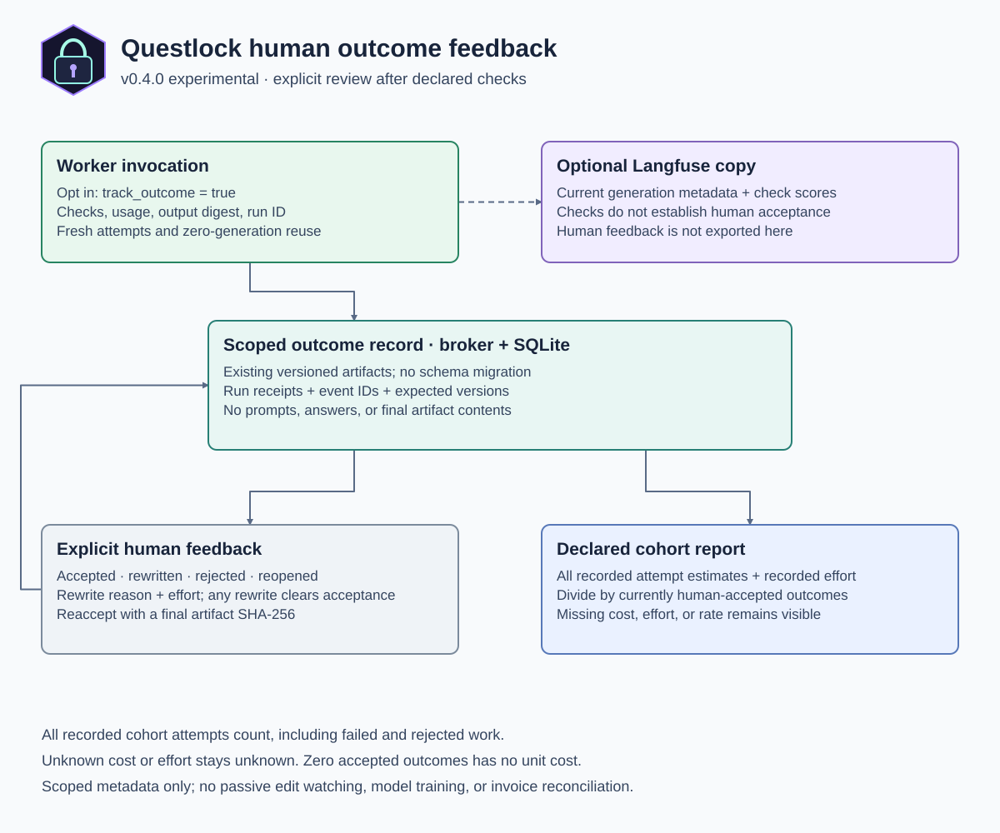

# From passed checks to human-accepted work

This describes the **v0.4.0 experimental candidate**, which is not yet a published
release. A worker passing its declared checks is useful evidence, but a person
can still have to correct the answer. The `outcomes` package adds explicit human
feedback and a scoped cost report to make that difference visible.

## What changes

Check success remains an observation about one attempt. Human acceptance is a
separate, revisable state for the work. Questlock can now connect the two through
content-free outcome records in its existing versioned broker artifacts.

An approved worker request can opt in with `"track_outcome": true`. Tracking
records the invocation and its attempts, including failed checks and exact reuse,
and returns an outcome receipt. The person reviewing the work then explicitly
records `accepted`, `rewritten`, `rejected`, or `reopened` feedback.

The result's `outcome_tracking` contains its `run_id`, task identity, and either
`status: "recorded"` with a receipt or `status: "failed"` with the content-free
run record for deliberate recovery. The opt-in flag is outside request identity,
so enabling tracking does not force a new model generation for a reusable task.

This closes the reporting gap behind “cost per accepted task.” Before this
feedback, the accurate denominator was a passed declared check. After explicit
feedback, the report can count **currently human-accepted outcomes in a declared
cohort**, with recorded generation costs and human effort included when known.



The [draw.io source](diagrams/human-outcomes.drawio) is editable with native boxes,
text, and connectors. No prompts, generated answers, or final artifact contents
are included in this diagram or the outcome record.

## Why acceptance is separate

Strict JSON and exact-value checks can pass while an answer misses a requirement
outside the declared checks. A stylistic edit and a correctness repair also mean
different things. A person supplies that distinction rather than Questlock
inferring it from an editor diff.

| Signal | Meaning for the outcome |
| --- | --- |
| A worker passes its declared checks | The attempt passed those expectations; human acceptance remains unset. |
| `accepted` | The reviewer accepts a linked attempt and identifies the final artifact by SHA-256. |
| `rewritten` | The reviewer changed the work for `correctness`, `style`, `requirements`, or `other`; any previous acceptance is cleared. |
| `rejected` | The work is currently rejected and does not count in the accepted denominator. |
| `reopened` | Previously resolved work needs review again; any previous acceptance is cleared. |

Every rewrite, including a style-only change, requires a later explicit
`accepted` event before the outcome counts as accepted again. Acceptance refers
to the recorded final artifact digest. It does not claim that an earlier model
answer was accepted unchanged or that the artifact is objectively correct.

Feedback events use an explicit event ID, linked run ID, and expected broker
artifact version. An exact retry can recover its receipt; a stale expected
version is a conflict to reconcile, not permission to overwrite another
reviewer's feedback. Keep the intended event before sending it, and retry only
that exact event after an ambiguous publication result.

## How to record a review

Build the candidate binary and start with its self-contained demonstration:

```sh
go build -trimpath -o bin/questlock ./cmd/questlock
./bin/questlock outcome quest
```

The quest runs real authenticated HTTP/broker storage with synthetic metadata,
without provider keys, a running model, or separate setup. It covers three
simple and three complex scenarios:

| Complexity | Scenario | Observable behavior |
| --- | --- | --- |
| Simple | A check-passing attempt is recorded, then reviewed | It starts `unreviewed`; only explicit feedback makes it `accepted`. |
| Simple | Accepted work is rewritten, then reaccepted | Rewrite removes acceptance; reaccept identifies the final artifact digest. |
| Simple | A run or review event is retried exactly | The original receipt returns without duplicating cost, effort, or version. |
| Complex | Accepted and failed/rejected tasks share one cohort | The numerator includes both tasks' recorded attempt costs and review effort. |
| Complex | Costs, effort, or rate are missing, or no task is accepted | Missing accounting stays `null`; no accepted denominator yields no unit cost. |
| Complex | Stale feedback arrives and the broker restarts | Stale feedback conflicts; acknowledged state survives; an old acceptance retry cannot overwrite a newer rewrite. |

For a live broker scope, keep the scoped credential in a protected file. A
worker's opted-in invocation records its run automatically. Importing another
integration's `Run` JSON is available through `outcome record`, but that input is
caller-reported evidence rather than an independently verified provider receipt.
All broker commands use the same `--broker` and `--timeout` options and
`QUESTLOCK_TOKEN` or `QUESTLOCK_TOKEN_FILE` environment as the model workflow.

```sh
export QUESTLOCK_TOKEN_FILE="/absolute/path/to/private/worker.token"
questlock outcome show --task ticket-extraction --revision approved-snapshot-1 \
  --broker http://127.0.0.1:8080
questlock outcome feedback --task ticket-extraction --revision approved-snapshot-1 \
  --expected-version 1 --event /absolute/path/to/private/review-event.json \
  --broker http://127.0.0.1:8080
questlock outcome report --cohort /absolute/path/to/private/cohort.json \
  --hourly-rate-usd 60 --broker http://127.0.0.1:8080
```

The expected version above is an illustration; use the version actually returned
by `show`. A review event has `id`, `run_id`, `kind`, and explicit `human_minutes`.
An acceptance also requires `final_artifact_sha256`; a rewrite requires `reason`.
Use opaque IDs and SHA-256 digests rather than placing task content in the
metadata. A cohort file is an explicit JSON array of `{ "id", "revision" }`.
Alternatively, report one task with `--task` and `--revision`.

The [runnable synthetic examples](../examples/outcomes/README.md) include complete
run, acceptance, rewrite, reacceptance, rejection, reuse, unknown-accounting, and
cohort JSON. They walk through check-passed work that is later corrected, including
how the denominator and retained costs change.

For a Go integration, construct `outcomes.Store{Broker: broker}` using an existing
`client.Client` for the intended scope. Keep a bounded context and use these
methods:

| Method | Contract |
| --- | --- |
| `Record(ctx, task, run)` | Append content-free current-invocation accounting; an identical run ID/payload recovers its original receipt. Run registration can retry broker version conflicts, but never an uncertain transport result. |
| `Get(ctx, task)` | Read the task's runs, feedback history, current state, and version. |
| `Feedback(ctx, task, expectedVersion, event)` | Record the intentional review decision against the version reviewed; a new event never rebases onto newer state. |
| `Report(ctx, tasks, hourlyRateUSD)` | Report 1–256 explicitly selected task revisions; a nil rate means unknown human valuation. |

`Task` has `id` and `revision`. `Run` has an explicit `id`, `request_digest`,
execution `status`, and `attempts`. Each attempt records declared-check success,
completion/durability, fresh or reused invocation status, usage coverage, output
digest, and nullable cost estimate with its basis. A known local token charge or
reuse charge can be zero; unknown cost is `null`. Stored snapshots also include
the broker version and creation time for each run and feedback event.

## What the cost report includes

Select the outcome IDs in the report cohort before interpreting its result. A
cohort can represent a sprint, experiment, or approved task set. It includes
recorded work that is pending, failed, rewritten, reopened, and rejected as well
as work that is currently accepted.

The numerator includes **all recorded attempts in that cohort**, not only the
successful attempt. An exact saved-answer reuse adds zero new generation usage;
it does not create another charge for the original generation. Multiple
invocations of the same outcome remain distinguishable through their run IDs.

When all required inputs are known:

```text
recorded work cost = configured generation-cost estimates
                   + recorded reviewer minutes × explicit hourly rate / 60

cost per currently accepted outcome = recorded work cost
                                   / number of currently accepted outcomes
```

Configured provider prices produce estimates, not provider invoices. A known
local provider token charge can be zero while hardware, electricity, and runtime
still cost resources. Reviewer time must be recorded explicitly, including zero
minutes when that is the intended known value. An omitted value is not zero.

`human_minutes` is incremental effort for that feedback event, not a running
total. The report sums the events. A task with no feedback contributes missing
human effort, even though it has zero recorded minutes; no review is inferred.

If any recorded attempt cost, effort value, or required hourly rate is unknown,
the combined cost metric stays unknown and the report exposes that missing
coverage. With no currently accepted outcomes, cost per accepted outcome is
undefined; the report does not divide by zero. Known partial totals can still
help explain which costs were recorded, but are not a complete unit cost.

`accepted_tasks` supplies the current denominator. `missing_inference_costs`,
`missing_usage`, and `missing_human_effort` expose coverage;
`known_inference_subtotal_usd` and `recorded_human_minutes` are partial recorded
totals. `inference_cost_usd`, `human_cost_usd`, `total_cost_usd`, and
`cost_per_accepted_task_usd` are nullable. Missing token usage is reported
separately from dollar cost: a known local token charge can be zero even when
token usage is unknown, and hardware remains excluded.

Reports state every selected task's observed version. They read tasks
individually, not as an atomic cross-task snapshot. Freeze review writes through
your application's workflow if a decision requires one fixed cohort view.

The report excludes surrounding hosted-assistant prompt, tool, and context
tokens; unrecorded model calls; unrecorded human work; hardware and electricity;
and work outside the selected cohort. Record those through an external accounting
system if the decision requires total business cost. Do not call this report an
invoice saving or a complete return-on-investment calculation.

## Shared storage and failure behavior

Outcome state uses the existing authenticated scope and compare-and-swap
publication API. There is no new SQLite schema, separate database, or shared
filesystem for workers. Only the broker owns its database; cooperating workers
read and publish outcome JSON through scoped HTTP.

Each task revision uses `outcomes/v1/tasks/<sha256>` with a hash derived from its
task identity. Its artifact allows at most 256 runs and 256 review events within
the broker's 1MiB artifact cap. A cohort report accepts at most 256 task revisions.
Changing the revision creates a separate outcome; it does not carry acceptance
forward. Existing records and artifacts are retained without automatic deletion.

The records contain run and event identifiers, checked-attempt metadata, usage
and cost estimates, artifact digests, feedback categories, and effort. They do
not contain prompts, generated answers, final artifact bytes, reviewer names, or
free-text review comments. Identifiers and digests are still retained metadata;
use dedicated scopes and opaque IDs for privacy boundaries.

Outcome registration is separate from generation. If registration cannot be
confirmed, the worker reports that tracking is unavailable. It never generates
again to repair a tracking failure. A generated result and an unavailable
outcome receipt therefore need independent review. Unregistered or otherwise
unrecorded work is outside the report's completeness guarantee.

The CLI emits the result JSON and exits unsuccessfully for tracking failure.
MCP keeps its checked answer with `outcome_tracking.status: "failed"`; callers
must inspect that status independently. Save the failed tracking `record` to a
private JSON file and deliberately use `outcome record` to recover only the
metadata. Preserve its original run ID and payload; do not rerun the model to
repair tracking.

All workers in a scope can read and write its artifacts. A credential proves
scope access, not that a feedback event really came from a human. The reviewing
application must request an intentional human decision and preserve its own
identity and authorization controls. Do not let an agent mark its own answer as
human accepted without that decision.

## Relationship to Langfuse and model routing

Langfuse's existing `questlock.quality` score describes declared checks for an
attempt. It is not human acceptance. This release keeps human feedback in the
Questlock broker and exposes it through the outcome API and CLI; it does not
automatically export feedback to Langfuse or watch edits in Codex or Claude Code.

The feedback loop records evidence for later model and workflow evaluation. It
does not retrain a model, choose a cheaper model automatically, change the
delegation escalation gate, or guarantee correctness. Direct OpenAI, Anthropic,
and local Ollama remain available. An OpenRouter companion adapter is still
planned; outcome accounting can compose with that provider layer once its
capability contract is implemented.

See [bounded delegation](delegation.md) for attempt execution,
[inference observability](inference-observability.md) for generation measurements,
and [model architecture](model-architecture.md) for budget and storage boundaries.
