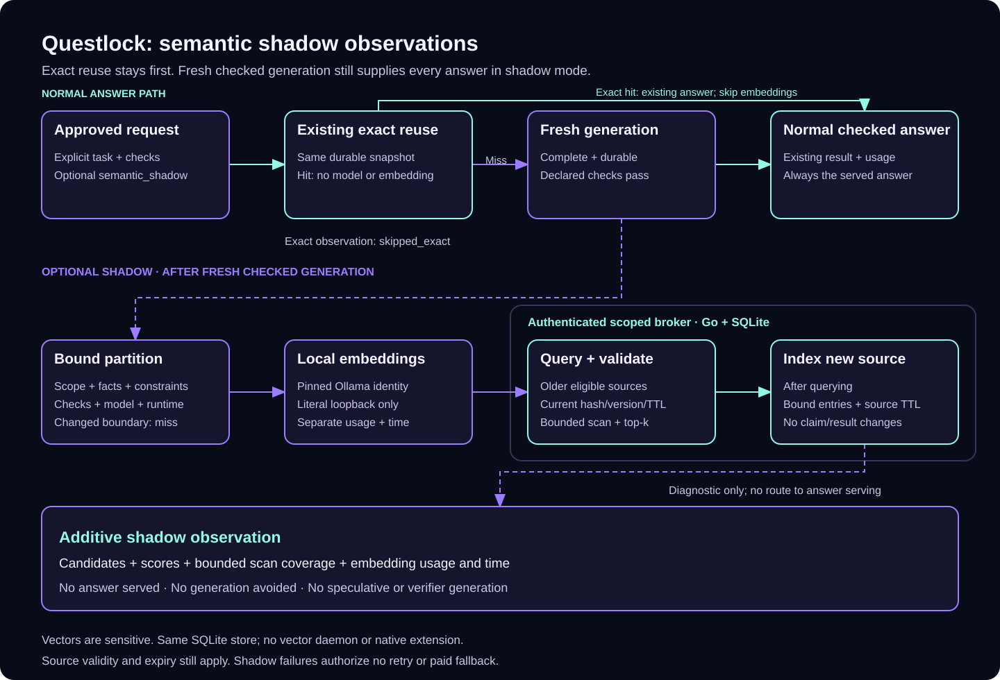

# Semantic shadow observations

Two questions can mean the same thing while using different words. They can also
look similar while one date, amount or policy changes the answer. **Questlock**
can observe possible completed-answer matches while the normal checked generation
still supplies the answer.

This release accepts only `mode: "shadow"`. A candidate is diagnostic evidence:
it serves no answer, avoids no generation, merges no task, claim or lock, and starts no
speculative generation or model verifier. Existing exact reuse runs first and
bypasses embeddings. A clean exact-only install needs no embedding weights.



[Editable draw.io source](diagrams/semantic-shadow.drawio).

## Request and run boundary

Add an optional top-level `semantic_shadow` object to an approved delegation
request. CLI and MCP use the same JSON:

```json
{
  "mode": "shadow",
  "family": "support-faq",
  "domain": "synthetic-support",
  "evidence_revision": "policy-1",
  "bindings": {"response_hours": "24"},
  "embedding_model": "all-minilm",
  "min_similarity": 0.9,
  "top_k": 3,
  "max_scan": 1000,
  "max_entries": 1000,
  "max_input_bytes": 8192,
  "timeout_ms": 10000
}
```

This object accompanies the usual `spec`, explicit model `policy`, and output
`checks`; it is not a complete request by itself. See the
[complete synthetic FAQ examples](../examples/semantic/README.md).

The observer runs after successful fresh generation produces a complete, durable
answer passing every declared check. It embeds the approved input, queries older
eligible candidates, then indexes the new source. Querying before insertion keeps
the current answer from matching itself. An exact repeat follows existing reuse
and reports `skipped_exact` without an embedding call.

The returned `semantic_shadow` observation is additive. It records candidate
scores, bounded scan coverage, indexing, embedding usage when reported, and
elapsed time separately from the original generation. It contains no alternative
answer. `generation_avoided` remains false. A missing
`embedding_input_tokens` is `null`, not zero. A candidate does not justify a
zero-token or avoided-token claim.

Generation usage and daily token-quota metrics exclude local embedding tokens;
those are reported separately. Input-byte and time limits bound embedding work.
No semantic candidate saves generation or establishes a bill saving.

| Observation status | Meaning |
| --- | --- |
| `skipped_exact` | Existing exact reuse succeeded; no embedding call occurred |
| `miss` | Bounded search returned no eligible candidate; the new source was indexed |
| `candidates` | Bounded search returned eligible candidates; the new source was indexed |
| A diagnostic status | Shadow work was unavailable, busy, resource-limited or failed; inspect its stage |

An unavailable model, invalid embedding, timeout or index failure produces a
shadow diagnostic. It changes neither the checked result nor its claim, and
authorizes no generation retry, paid fallback or source-lifetime extension.

## What must stay the same

Similarity is evaluated only within a bound partition. The broker derives scope
from the authenticated credential. Identity also binds the declared domain,
family, evidence revision and variables; actual task and revision; instructions,
context and output checks; model tier; and pinned generation runtime. The
embedding model identity separates incompatible vectors.

Keep facts in approved context and explicit `bindings`, and advance
`evidence_revision` when evidence changes. A family label is not permission to
reuse across different tasks, facts or constraints. Changing a bound field or
broker scope misses even when the wording is nearly identical. Omitting an
important fact from these declarations does not make a score a validity check.

The examples change only the question's wording for a positive pair. Their
negative control changes the policy, task revision, evidence revision, binding
and expected fact. A high similarity score on that wording cannot bridge the
partition change.

Candidates must still refer to the exact current source version and content
hash, a complete checked result and an unexpired reuse window. Validation also
resolves sources moved into local cold storage. Superseded, damaged, missing,
incomplete or expired sources do not become eligible through the index. Semantic
entries never extend their source's TTL. Archive corruption or unavailability
fails the observation; it is not a cache miss.

## Local embedding setup

Embeddings use a separately installed Ollama model. **Questlock** does not bundle
model weights in its core binary. The following explicit setup command requests
the embedding weights from the local Ollama daemon and may download them:

```sh
questlock semantic init --model all-minilm \
  --ollama-url http://127.0.0.1:11434
```

Review `questlock semantic init --help` before running it. Workers never download
missing weights automatically. Initialization does not enable shadow mode in
existing requests or change a client's configuration. Model tags in these
examples are examples, not measured quality recommendations.

Only literal loopback is accepted for the embedding endpoint, such as
`127.0.0.1` or `[::1]`. Environment proxies and redirects are disabled. Request
JSON cannot select another host. A failed model call has no paid fallback.
The worker's `--ollama-url` selects the local runtime for the approved run.

With a broker token in `QUESTLOCK_TOKEN_FILE` or `QUESTLOCK_TOKEN`, an installed
generation model and embedding weights:

```sh
questlock worker run --request examples/semantic/support-faq.request.json \
  --broker http://127.0.0.1:8080 \
  --ollama-url http://127.0.0.1:11434
```

This command performs local inference for a fresh task. For MCP, first call
`questlock_status` to discover the worker's `request_root`, place the approved
request inside that root, and call `questlock_delegate` with its `request_path`.
The same checks and shadow-only boundary apply. See
[worker setup and request-file rules](delegation.md#run-or-expose-the-worker).

The example uses [Ollama's `all-minilm`](https://ollama.com/library/all-minilm).
For upstream model background and its Apache-2.0 license, see the
[Sentence Transformers `all-MiniLM-L6-v2` model card](https://huggingface.co/sentence-transformers/all-MiniLM-L6-v2).
Weights are installed separately and are not bundled with **Questlock**.

## From Go

Given a scoped `broker` of type `*client.Client` and your existing
`callerFactory` of type `delegation.RunnerFactory`, add the observer:

```go
router := delegation.Router{
    Factory: callerFactory,
    Shadow: &delegation.ShadowObserver{
        Broker: broker,
        Index:  broker,
        EmbedderFactory: func(ctx context.Context, c semantic.Config) (semantic.Embedder, error) {
            return semantic.NewOllamaEmbedderContext(
                ctx, "http://127.0.0.1:11434", c.EmbeddingModel, c.MaxInputBytes,
            )
        },
    },
}
result, err := router.Run(ctx, approvedRequest)
```

Import `context`, `github.com/spfuzzylink/questlock/delegation` and
`github.com/spfuzzylink/questlock/semantic` alongside your existing client setup.
`*client.Client` satisfies the semantic index interface. The approved request
must explicitly set `SemanticShadow`; the observer does not enable itself for
other requests.

Your factory's runner must expose `RuntimeIdentity() string` from its underlying
`inference.Runner`; wrappers must forward that method. Without it, shadow work
reports `runtime_identity_unavailable`. The observer closes each returned Ollama
embedder after its observation. A Go caller can set `Resources` to its local
admission source; leaving it unset relies on the caller's own admission. This
still serves only the normal checked answer and avoids no generation.

## Storage and resource limits

Vectors live in the same Go/SQLite broker. There is no extra vector daemon or
native SQLite extension. Authenticated `POST /v1/semantic/query` and
`POST /v1/semantic/entry` use the caller's broker scope. Workers do not open the
database directly. Protect the database and backups as sensitive task data;
embeddings can reveal information about their inputs and are not anonymization.

| Request setting | Default | Maximum |
| --- | ---: | ---: |
| `min_similarity` | 0.9 | 1.0 |
| `top_k` | 3 | 10 |
| `max_scan` | 1,000 | 10,000 |
| `max_entries` | 1,000 | 10,000 |
| `max_input_bytes` | 8,192 | 32,768 |
| `timeout_ms` | 10,000 | 60,000 |

The scan and result limits bound work; a truncated scan is not proof that no
other match exists. Entry capacity applies across the authenticated scope, not
separately to each family or model. Entries expire by their source's expiry and
at most 24 hours after source creation. Vectors are limited to 4,096 dimensions.
The shadow timeout bounds added work and remains subject to the caller's earlier
deadline. The worker admits one observation at a time and skips it under local
resource pressure. This is local process admission; host CPU, RAM and disk
capacity still need operator limits. See the
[security boundary](../SECURITY.md#semantic-shadow-data).

## Qualification and limits

Run the deterministic offline quest without a model account or weights:

```sh
questlock semantic quest
```

The qualification set covers six paired cases. Each uses a paraphrase with
unchanged evidence and a negative control that changes a relevant boundary:

| Case | Positive pair | Negative control |
| --- | --- | --- |
| Support FAQ | Same password-reset evidence, reworded question | Changed evidence revision |
| Onboarding | Same wiki-access evidence, reworded request | Changed domain |
| Incident handoff | Same incident evidence, reworded summary request | Changed bound period |
| Release readiness | Same approved commit and checks, reworded request | Changed bound commit |
| Refund answer | Same order and policy, reworded customer question | Changed bound order |
| Shared-broker lifecycle | Same scoped source from a second credential after reopen | Changed evidence revision |

These are fixture checks with simulated embeddings and timings. They establish
protocol and isolation behavior, not embedding quality, model latency, human
acceptance or production savings. A real qualification must use explicit local
weights and matched tasks, retain misses and false candidates, and record
generation and embedding overhead separately. The lifecycle fixture uses two
isolated clients on one physical host; it is not a physical multi-machine result.

To qualify installed local embeddings while keeping generation simulated:

```sh
questlock semantic quest --live --embedding-model all-minilm \
  --ollama-url http://127.0.0.1:11434
```

This explicitly contacts the local embedding runtime. It does not measure live
text generation or remove the need for task-specific quality review.

The [recorded local smoke check](semantic-shadow-validation-v0.14.0.json) passed
all six cases with real `all-minilm` embeddings and deterministic fixture
generation. It made 18 embedding calls; six exact repeats skipped embeddings,
and six negative controls missed their guarded partitions. Positive cosine
scores ranged from 0.9294 to 0.9928 at the explicit fixture threshold of 0.8.
The default remains 0.9.

These are the same six authored positive pairs, not a held-out benchmark or
threshold calibration. Their scores do not prove answer equivalence or establish
quality on other inputs. The six-case suite measures no live text generation,
human acceptance, generation saving or bill saving.

The same record includes a separate live `qwen3.5:4b` writing check. Fresh
generation passed its declared checks, an exact repeat used zero new generation
tokens, and a paraphrase generated normally while observing a candidate. This
small check establishes neither human acceptance nor general model quality.
Shadow observations add work and serve no semantic answer.
