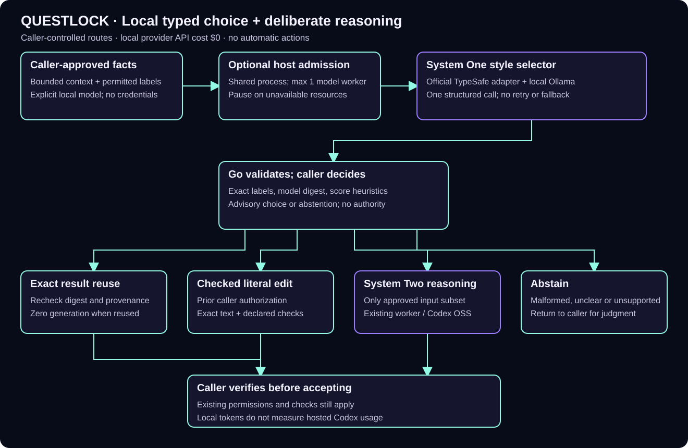

# Optional local typed decisions

Questlock can ask an explicitly selected local Ollama model to recommend one of
2–8 caller-approved labels. The optional Python bridge uses TypeSafe AI's
official [System One adapter v0.2.1](https://github.com/typesafe-ai/system-one-adapter-python/tree/v0.2.1),
commit `e1d4cc938204b22fc5a3c3aca7044072fe3f712d`, through its documented custom
provider interface. Go validates the complete request, local model metadata,
returned labels, score distribution and caller heuristics. It returns an
advisory choice or abstention. It never executes the suggested action.

This is a System One style **selector** paired with an optional deliberate local
reasoning lane through the existing [worker or native Codex OSS launcher](local-models.md).
The deliberate lane is System Two style reasoning; these are workflow labels.
It uses ordinary caller-selected Ollama weights, including the tested
`qwen3.5:4b`; it does not include Jev weights, reproduce Jev behavior, or make a
neuroscience claim. The TypeSafe adapter and SDK are external MIT dependencies.
Normal Questlock commands remain Go programs with no Python requirement.



[Editable draw.io source](diagrams/system-one.drawio).

## Prepare explicitly, then choose

Use Python 3.12 in a dedicated environment. The optional lock pins the adapter
wheel by SHA-256 and pins the tested SDK and transitive versions. Install from
the official Python package index; no provider SDK extra, account or credit is
needed. Installing this environment does not install or download model weights.

```sh
python3.12 -m venv /absolute/private/system-one-venv
/absolute/private/system-one-venv/bin/python -m pip install --isolated --index-url https://pypi.org/simple -r optional/system-one/requirements.txt
umask 077
questlock system-one choose --request optional/system-one/reuse.json --python /absolute/private/system-one-venv/bin/python > /absolute/private/choice-receipt.json
```

Ollama must already be listening at literal `http://127.0.0.1:11434` with the
explicit model tag installed. The endpoint cannot be overridden. Discovery
rejects cloud names and remote metadata; pre/post discovery must identify the
same installed digest. No automatic pull, paid provider, credential import,
proxy, redirect, provider fallback or retry is offered. Public Questlock provider
integrations remain separate and unchanged.

The bridge runs under Python `-I -B` with a temporary private home, bounded
stdin/stdout and only `HOME` and interpreter-directory `PATH` in its environment.
It uses the adapter's structured JSON schema with probability normalization and
both retry mechanisms disabled. One Ollama `/api/chat` request has `think:false`,
`stream:false`, `temperature:0`, an 8192-token context and at most 256 output
tokens. Unsupported thinking/tool output or a non-stop completion abstains.
The bridge is an internal transport embedded in the Go runner; invoke the Go
API/CLI so its complete request and local-model checks run.

The request path must be a bounded regular file on macOS or Linux; symlinks,
special files and replacement inodes are refused. The request is at most 16 KiB,
with at most 4096 UTF-8 bytes across state,
question, labels and descriptions. Question and each description are at most
512 bytes. The total deadline defaults to 60 seconds and cannot exceed 120
seconds. A model failure produces `status:"abstained"`; a successful process
exit alone does not mean a choice was made. Invalid configuration/input also
returns a CLI error. Callers must inspect `status` and `choice_id`.

## Keep permissions with the caller

The [example request](../optional/system-one/route.json) offers `reuse`,
`checked_edit`, `local_reasoning` and `abstain`. These are recommendations about
the next step. The caller must build its allowed set from independently checked
facts, rather than placing permissions or secrets into model context:

```go
choices := []systemone.Choice{{ID: "abstain", Description: "Return to the caller."}}
if exactResultWasIndependentlyVerified {
    choices = append(choices, systemone.Choice{ID: "reuse", Description: "Recommend exact result reuse."})
}
if literalEditWasAlreadyAuthorized {
    choices = append(choices, systemone.Choice{ID: "checked_edit", Description: "Recommend a checked literal revision."})
}
if boundedLocalTaskWasAlreadyApproved {
    choices = append(choices, systemone.Choice{ID: "local_reasoning", Description: "Recommend the approved local task."})
}
// Fewer than two choices needs no model: return to the caller directly.
request := systemone.Request{Schema: systemone.Schema, Model: "qwen3.5:4b",
    State: boundedFacts, Question: "Recommend one allowed next step; abstain if unclear.",
    Choices: choices, Policy: &systemone.Policy{MinScore: 0.75, MinMargin: 0.2}}
result, err := (systemone.Runner{Python: pinnedPython}).Choose(ctx, request)
if err != nil || result.Status != "chosen" {
    return // caller handles abstention
}
// Caller rechecks its evidence and approvals before using result.ChoiceID.
```

Do not send the entire decision context or chat history to the reasoning worker.
After a `local_reasoning` recommendation, the caller can submit only its
separately approved request file from the fixed worker workspace using the
existing `questlock_delegate` tool. That file contains an allowed task and the
small approved `spec.input`/`spec.context` subset, not the adapter debug trace.
The [approved local task example](../optional/system-one/approved-local-task.json)
declares only its ticket text, one installed local model and exact output checks,
with no escalation tier. After separate approval, copy it into the fixed worker
workspace and submit `{"request_path":"approved-local-task.json"}` to
`questlock_delegate`. This handoff does not copy the selector's state or scores.
Worker checks and
review of generated text still apply. `checked_edit` requires the existing exact
source hash, old-text occurrence counts and deterministic checks. A recommendation
does not authorize filesystem edits or publication.

For an exact-result example, use disposable explicit state and workspace paths:

```sh
questlock try --state-dir /absolute/private/demo-state --workspace /absolute/private/demo-requests
questlock system-one choose --request optional/system-one/reuse.json --python /absolute/private/system-one-venv/bin/python
# Independently verify the first receipt and explicitly approve this next step.
questlock try --state-dir /absolute/private/demo-state --workspace /absolute/private/demo-requests
questlock local stop --state-dir /absolute/private/demo-state
```

The second checked revision reports `reused:true` and `generation_called:false`.
`try` uses the actual MCP protocol with a disposable managed broker; its receipt
correctly retains `native_client_verified:false`. The selector does not trigger
that reuse automatically. If an exact result is already known valid, deterministic
reuse can be chosen directly without spending even a local selector call.

## Share host admission explicitly

When using the optional shared `admission` scheduler, submit the entire selector
operation on `LaneInference`. One scheduler instance can admit broker, replication
Push/Pull, checked revision and local inference work in the same process. Its
default inference maximum is one; unknown/stale resource samples pause admission.
The callback remains an ordinary Go function, so model policy and result reuse
have no scheduler dependency:

```go
scheduler, err := admission.New(admission.DefaultConfig(),
    func(ctx context.Context, job admission.Job) error {
        request, err := systemone.Load(bytes.NewReader(job.Payload))
        if err != nil { return err }
        result, err := (systemone.Runner{Python: pinnedPython}).Choose(ctx, request)
        savePrivateReceipt(job.ID, result) // caller-owned; also save abstentions
        return err
    })
if err != nil { return err }
runCtx, stop := context.WithCancel(ctx)
defer stop()
runErrors := make(chan error, 1)
go func() { runErrors <- scheduler.Run(runCtx, admission.SystemSource()) }()
future, err := scheduler.Submit(ctx, admission.Job{
    ID: "choice-1", Lane: admission.LaneInference, Payload: approvedBoundedJSON})
if err != nil { return err } // paused/full requests never reach the callback
select {
case outcome := <-future:
    return outcome.Err // completed execution can still contain an abstention
case err := <-runErrors:
    return err
case <-ctx.Done():
    return ctx.Err()
}
```

Use a separate already-approved local worker callback on the same inference lane
for deliberate reasoning. Admission does not shrink prompts, retune scores,
retry, choose a provider, or authorize work. Separate processes do not share this
in-memory limit, and the existing MCP worker's single-active/`worker_busy` rule
still applies. The snippet assumes the shared controller is integrated; the
selector package itself imports no admission package.

## Receipts and limits of evidence

`uncalibrated_scores` are model-generated label scores, **not calibrated
probabilities of correctness**. Required `min_score` and `min_margin` are explicit
caller heuristics. Ties, low margins, malformed distributions, null/nonnumeric
scores, unpaired Unicode surrogate escapes, unknown labels,
incomplete responses, unsupported dependencies and changed/unavailable model
snapshots abstain. No heuristic creates a quality-calibrated fallback.

Receipts contain request SHA-256, model digest, adapter version, local input/output
token counts when reported, model-call count, retry count and elapsed/adapter
latency. Unknown counts remain `null`, including a call count when a killed
process cannot establish whether inference started. Prompts, adapter debug
traces and raw errors are omitted; keep receipts private because labels, scores,
hashes and model metadata can still be sensitive.

`provider_cost_usd:0` means this fixed local path made no paid provider request.
It excludes electricity/hardware and the hosted assistant's subscription usage
while developing or coordinating this feature. Local tokenizer counts are not
hosted Codex usage. A hosted-usage reduction claim requires a matched before/after workflow
measurement and is not established by this integration or its smoke test. The hosted Codex coordinator implemented this integration; the local model
only supplied the recorded bounded decisions.

## Reproduce offline contracts

From a source checkout (the release archives include runtime setup inputs, not
the full Go/Python test source):

```sh
go test ./systemone ./cmd/questlock
/absolute/private/system-one-venv/bin/python optional/system-one/test_bridge.py
```

Go tests inject model discovery and bridge responses, and inspect an actual
subprocess's isolated environment. They need no Python or model. Optional Python
tests exercise the real pinned adapter with an offline fake transport, including
malformed structures, missing usage, cloud rejection and zero retries. Neither
suite downloads weights or calls a paid service.

On the development Mac, three bounded real local model calls were made: the
initial two-label adapter compatibility call passed (170 input / 41 output local
tokens, 6.31s adapter latency); the four-label illustration returned an invalid
score distribution and correctly abstained (188 / 65, 6.20s total); a separate
two-label full Go CLI request passed (170 / 41, 1.72s total). Each made one local
call with zero retries and $0 provider API cost. The last run also verified an
explicitly approved MCP exact-result replay with `reused:true` and no generation.
The first four-label failure was retained privately; there was no automatic
retry or fallback. These smoke cases establish transport and policy behavior,
not selector quality, calibration or a hosted-usage reduction percentage.
