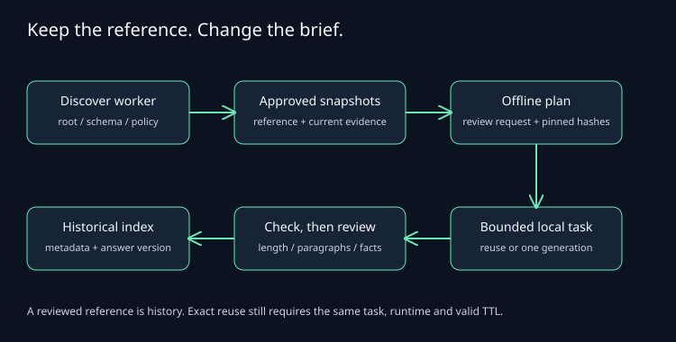

# Repeated writing, without copying the whole chat

You have the facts and a writing style already. The next task changes one brief,
not your whole background. **Questlock** keeps that distinction explicit.

Start with [the synthetic walkthrough](../examples/writing/README.md).
`writing init` pins an approved local reference. `writing plan` combines it with
the current evidence and a bounded recipe. It creates a request to review, not
a model call. No private profile is included in the public package.

[Edit the diagram](diagrams/writing-workflows.drawio).

## Finding it in another chat

Call `questlock_status` with `{}` first. Its declared `request_root` and
`workflow_configs.writing` identify the known private config path. This is a
location hint, not proof the file exists or the broker/model is healthy. The
worker does not scan your files, inspect old chats or print your reference.

The config contains an explicit absolute reference path, its SHA-256 and the
recipe. If the reference bytes change, planning stops until you review the new
reference and update the private hash. Current evidence is a separate, explicit
file each time. Source text and source revisions both contribute to the request
identity; changing a fact changes the snapshot even if you forget to rename it.

## A contract a small model can follow

The default recipe asks for plain prose, 130–165 words and two paragraphs.
Keyword presence alone would allow a 193-word answer to pass a 165-word limit;
`word_count` now rejects it and reports `observed: 193`.

All count bounds are inclusive and configurable. Each check needs `min`, `max`
or both. Zero is valid; at least one bound is required.

| Check | What gets counted |
| --- | --- |
| `word_count` | Nonempty spans separated by Unicode whitespace. Punctuation stays with its word. |
| `character_count` | Unicode code points, including spaces and line endings. A CRLF counts as two. |
| `paragraph_count` | Groups of nonempty lines separated by one or more whitespace-only blank lines. Leading/trailing blank lines do not count. |

Counts do not measure truth, tone, usefulness or tokenizer usage. The engine
rejects invalid UTF-8 or text over 4 MiB. Bounds range from 0 to 4,194,304.
Unsupported fields, duplicate JSON keys and conflicting bounds stop validation.
Existing checks keep their previous behavior.

## Keep history separate from reuse

After a complete, durable answer passes its checks, `writing record` verifies
the answer against the authenticated broker and the approved request's stored
fingerprint. It writes immutable metadata with reference/evidence versions,
answer key/version/hash, and `unreviewed` or `assistant_reviewed` status.
`human_acceptance` stays `not_asserted`. Older jobs without this request
provenance remain usable for inference; the writing index refuses to attest them.

The per-reference index holds up to 128 metadata references within 128 KiB.
Concurrent updates use version checks with bounded retries; they never rerun a
model. A full index stops new indexing and keeps the existing entries. Choose
a new explicitly versioned reference ID for another series. An uncertain index
write needs reconciliation of the same saved result, not new generation.

`writing show` fetches metadata only. Answer content still lives in its scoped
broker artifact. Indexing does not extend the inference reuse window: exact
reuse still requires the same request, provider/runtime identity and an unexpired
result. The maximum inference reuse window remains 24 hours. A months-old answer
can be a reference for review; it is not automatically a fresh cache hit.
[Local cold history](storage-retention.md) keeps eligible older payloads with the
same storage safeguards and limits.

## Count the attempts, too

A preflight budget stop makes zero generation calls and marks checks `not_evaluated`.
Incomplete, uncertain or over-budget output does not get an ordinary quality
score. A complete rejected answer stays rejected; the recipe has no automatic
model switch or paid escalation. Review the diagnostics, then deliberately
change the task or policy if needed.

Record failed attempts and later rewrites alongside the answer. Use
[outcome feedback](outcomes.md) for human acceptance and actual effort; leave
unobserved values unknown. A successful contract or a reused answer does not
prove saved reviewer time, better quality or reduced whole-chat credits.
